FLFHMCLauncher is the shell around FLFHMCL, implemented in C++ with static Qt. It is not the Java runtime and does not load Fabric classes. It manages instances, components, commands, updates, and process lifetime.

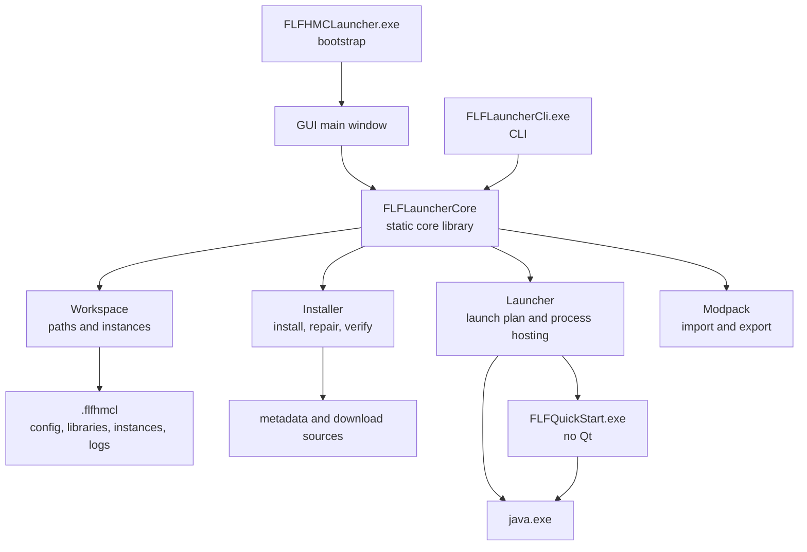

## 1. Design goals

- single-file EXE with minimal runtime dependencies;
- static Qt, so users do not install Qt;
- full Chinese-path support;
- instance isolation, shared libraries, quick start;
- diagnosable failures instead of silent crashes;
- decoupling from FLFHMCL/mclhr: consume their artifacts only.

## 2. Modules

```text
src/
├─ bootstrap_main.cpp     self-extract/bootstrap
├─ cli_main.cpp           CLI
├─ quickstart_main.cpp    quick-start launcher
├─ main.cpp               GUI entry
├─ core/
│  ├─ workspace.*         workspace/instances
│  ├─ installer.*         install/download/verify
│  ├─ launcher.*          launch plan/quick start
│  ├─ modpack.*           .flfhmclpack
│  ├─ quickstart_config.* embedded config
│  ├─ meta.*              metadata
│  ├─ http.*              WinHTTP
│  └─ mods.*              mod scanning
└─ ui/mainwindow.*        Qt UI
```

## 3. Bootstrap

The release `FLFHMCLauncher.exe` carries the GUI, QuickStart, DLLs, and resources in a payload. On first run it:

1. reads the payload;
2. extracts to `.flfhmcl/bin`;
3. verifies versions;
4. starts the GUI.

The bootstrap itself is built with `/MT` and depends only on Windows system DLLs.

## 4. Workspace

`Workspace` is responsible for:

- locating `.flfhmcl`;
- reading configuration and the instance list;
- resolving profile, `.minecraft`, and `.hmcl`;
- resolving mods, libraries, Agent, and HMCL paths.

All paths written to JSON/JVM arguments are UTF-8 to avoid Chinese-path corruption.

## 5. Installer

The installer:

- fetches metadata;
- selects mirrors;
- downloads;
- verifies SHA-1/SHA-256;
- performs atomic replacement;
- rolls back on failure.

Long tasks must support cancellation; cancellation removes temporary files without damaging the existing instance.

## 6. Launch plan

`buildLaunchPlan` produces:

- the Java executable;
- the `-javaagent` Agent;
- `-Dflf.*` system properties;
- `-Dfabric.addMods`;
- the HMCL jar;
- the Knot main class;
- the `--gameDir` (HMCL working directory) and instance arguments.

The Knot provider is used by current FLFHMCL; the legacy provider handles old `-jar` launches. Argument order is significant.

## 7. Quick-start launcher

The quick-start launcher is a separate EXE. Its configuration is appended with a `FLFQS01` payload:

```text
[JSON][uint64 length][FLFQS01\n]
```

The configuration contains:

- `root`;
- `instance`;
- `modsDir`;
- `command`;
- `workingDir`;
- `checkUpdates`.

At runtime it:

1. reads the payload;
2. re-scans `modsDir`;
3. rebuilds `-Dfabric.addMods`;
4. parses/rebuilds the command line with `CommandLineToArgvW`;
5. starts Java with `CreateProcessW`;
6. waits for the child and returns its exit code.

It must ensure that mod additions/removals need no regeneration, and that both Java and the quick-start process exit after HMCL closes. An earlier implementation leaked a non-daemon Swing timer; that is fixed.

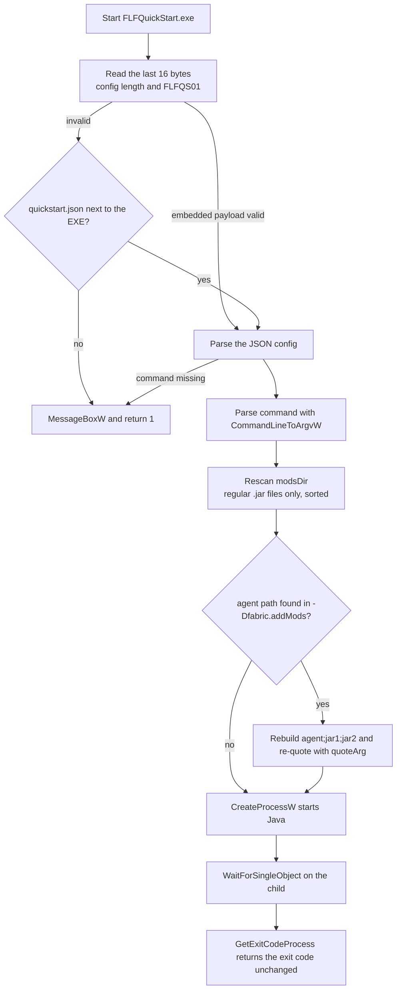

## 8. Modpacks

`.flfhmclpack` is read/written by `modpack.cpp`:

- metadata;
- instance files;
- layer configuration;
- import/export;
- path rewriting;
- rollback on failure.

Imports must not blindly overwrite user data; follow the pack policy.

## 9. UI

The Qt Widgets main window handles instances, accounts, downloads, settings, and logs. Long tasks run on worker threads and report progress via signals; never block the GUI thread.

## 10. Logging and CLI

- CommonLoggerCPP records logs;
- CrashTrackerHandleLibCPP captures crashes;
- CLI supports `launch`, `quickstart`, `validate`, and `repair`;
- exit codes are stable for scripts.

## 11. Build

```powershell
pwsh -NoProfile -File scripts\build.ps1
```

Or:

```powershell
cmake -B build -S . -G Ninja `
  -DCMAKE_BUILD_TYPE=Release `
  -DCMAKE_PREFIX_PATH="H:/Qt-static/6.11.1/msvc2022_64" `
  -DCMAKE_TOOLCHAIN_FILE="H:/vcpkg/scripts/buildsystems/vcpkg.cmake" `
  -DVCPKG_TARGET_TRIPLET=x64-windows
cmake --build build --config Release
cmake --build build --target package-release
```

## 12. Testing

- quick start: mod add/remove, exit after close;
- Chinese paths;
- overwrite upgrade;
- missing Agent/API;
- HMCL version mismatch;
- corrupt pack import;
- CLI exit codes.

## 13. Pitfalls

- freezing the mod snapshot in the quick-start launcher;
- lingering Java processes from non-daemon threads;
- overwrite installs without rollback;
- absolute paths baked into movable packs;
- temporary files left after cancellation;
- non-UTF-8 path handling.

## 14. Architecture and module responsibilities

The release artifact is one `FLFHMCLauncher.exe`, but CMake builds five targets: a static core library, the GUI, the bootstrap, the CLI, and the quick-start launcher. The bootstrap concatenates itself, a payload, and a 24-byte footer into one file, extracts the payload to `.flfhmcl/bin` at run time, and hands the outer directory to the GUI through an environment variable. The deliverable is a single file while the code stays layered.

| Target | Kind | Entry | Main dependencies | Notes |
|---|---|---|---|---|
| `FLFLauncherCore` | static library | `src/core/*.cpp` | Qt6::Core, nlohmann_json, CommonLoggerCPP, CrashTrackerHandleLib, winhttp | all business logic, shared by GUI and CLI |
| `FLFHMCLauncherApp` | WIN32 GUI | `src/main.cpp` | Core, Qt6::Widgets, Qt6::Concurrent | the real main window process |
| `FLFHMCLauncher` | WIN32 | `src/bootstrap_main.cpp` | shell32 | built with `/MT`, output name `FLFHMCLauncherBootstrap.exe` |
| `FLFLauncherCli` | console | `src/cli_main.cpp` | Core, Qt6::Core | headless install, repair, self-test |
| `FLFQuickStart` | WIN32 | `src/quickstart_main.cpp` | shell32 | per-instance launcher without Qt |

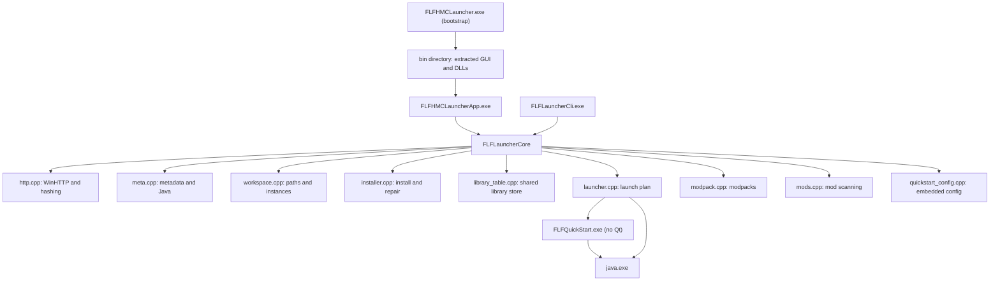

| File | Responsibility | Key symbols |
|---|---|---|
| `core/flf_paths.cpp` | locates the launcher directory, workspace root, and log path; creates the directory skeleton | `executableDirectory`, `flfHome`, `ensureLayout` |
| `core/app_bootstrap.cpp` | initializes logging and the crash handler | `bootstrap`, `shutdown` |
| `core/workspace.cpp` | workspace singleton: config, instance list, path resolution, legacy migration | `Workspace::get`, `resolveMinecraft`, `resolveMods` |
| `core/http.cpp` | WinHTTP GET, resumable and chunked downloads, SHA-1/SHA-256 | `httpGet`, `httpDownload`, `sha256File` |
| `core/meta.cpp` | version, Fabric, HMCL, and FLF metadata; Java detection and install | `fetchFabricProfile`, `fetchFlfRelease`, `detectJava` |
| `core/library_table.cpp` | shared library index, hash-cache restore, filling gaps | `LibraryTable::ensure`, `restore` |
| `core/installer.cpp` | instance install, repair, CrashTracker deployment | `installInstance`, `repairInstance`, `ensureCrashTracker` |
| `core/launcher.cpp` | launch plan, launch protocols, process hosting, quick-start generation | `buildLaunchPlan`, `launchInstanceManaged`, `writeQuickStart` |
| `core/mods.cpp` | list, enable/disable, import, delete mods | `listMods`, `setModEnabled` |
| `core/modpack.cpp` | `.flfhmclpack` import and export | `exportModpack`, `importModpack` |
| `core/quickstart_config.cpp` | writing, truncating, and reading the embedded config | `appendQuickStartConfig`, `loadQuickStartConfig` |
| `ui/mainwindow.cpp` | Qt Widgets UI, thread dispatch, launch output display | `MainWindow` |

Apart from Qt6::Core pieces such as `QCryptographicHash`, `QProcess`, `QStandardPaths`, and `QTemporaryDir`, the core layer never touches the UI. Every path written to JSON or to a JVM argument must pass through `pathUtf8` in `path_util.h`, because on Windows `path::string()` returns the active ANSI code page and non-ASCII paths would become invalid UTF-8.

## 15. Bootstrap: payload layout, extraction, and self-update

Tail structure of the release EXE, all little-endian:

```text
[ bootstrap PE ][ payload ][ 24-byte footer ]
footer : magic "FLFEND01"(8) + uint64 offset + uint64 size
payload: magic "FLFPAY01"(8) + uint32 version(=1) + uint32 count(at most 64)
entry  : uint32 nameLen + name(UTF-8, at most 260 bytes) + uint64 size + file data
```

Reading order: get the module path with `GetModuleFileNameW`, seek to the last 24 bytes and read the footer, verify the magic, a non-zero `size`, and `offset + size` within `fileSize - 24`, then read the payload, verify `FLFPAY01` and the version, and finally parse every entry. An entry name containing `/`, `\`, `:`, `.`, or `..` marks the payload as corrupt, so the payload can never write outside `bin`.

Extraction has three steps: create `.flfhmcl/bin`; write each entry to `<target>.tmp` and replace it atomically with `MoveFileExW(MOVEFILE_REPLACE_EXISTING | MOVEFILE_WRITE_THROUGH)`; write the `.payload` marker containing `<offset>-<size>`. On the next start `payloadCurrent` checks both the marker and the presence of every entry and skips extraction entirely when they agree.

To start the GUI it sets `FLFHMCL_LAUNCHER_DIR`, calls `CreateProcessW` with the launcher directory as working directory to run `FLFHMCLauncherApp.exe`, forwards the command line after the exe name unchanged (`commandLineAfterExe` skips a quoted program name), and closes the handles immediately without waiting for the GUI.

Three tolerances apply: while the GUI is running it holds files in `bin`, `MoveFileExW` fails, and the bootstrap still starts the existing version as long as `FLFHMCLauncherApp.exe` exists; a development directory without a payload falls back to the app next to the bootstrap; only when no app can be found at all does it show a `MessageBoxW` and return 1.

For self-update the bootstrap downloads nothing; it only guarantees that a different EXE triggers a fresh extraction. After a new build overwrites the release EXE, the `offset/size` in the footer changes, the `.payload` marker no longer matches, and the next run extracts into `bin` again. The overwrite must happen after the GUI has fully exited, because the mapped EXE and DLLs cannot be replaced; `.flfhmcl` is not part of the payload, so instances, libraries, and logs survive an EXE replacement.

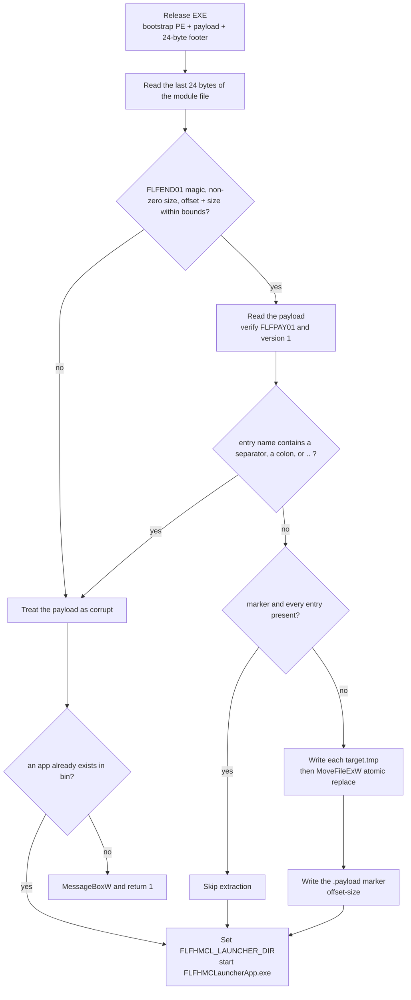

## 16. Workspace path resolution

`Workspace` is a process-wide singleton. `initialize()` first calls `ensureLayout()` to build the skeleton (`bin`, `config`, `libraries`, `java`, `javafx`, `fabric`, `hmcl`, `tools/CrashTracker`, `instances`, `cache/downloads`, `cache/meta`, `logs`, `crash-report`), then reads `config/launcher.json` and `config/instances.json`.

| Purpose | Location | Resolved by |
|---|---|---|
| Launcher directory | `FLFHMCL_LAUNCHER_DIR` if set, otherwise the module directory | `executableDirectory` |
| Workspace root | `<launcher dir>/.flfhmcl` | `flfHome` |
| Global config | `.flfhmcl/config/launcher.json` | `saveConfig` |
| Instance list | `.flfhmcl/config/instances.json` | `saveInstances` |
| Instance directory | `.flfhmcl/instances/<uuid>`, falls back to the id when the uuid is empty | `instanceDir` |
| Instance profile | `.flfhmcl/profile/<uuid>` | `profileDir` |
| mclhr manifest | `.flfhmcl/profile/<uuid>/mclhr.json` | `manifestPath` |
| Mods directory | shared mode `.flfhmcl/mods/general`, otherwise `.flfhmcl/mods/<uuid>` | `resolveMods` |
| Minecraft instance directory | isolated instance `../.launcher/<uuid>/.minecraft`, otherwise `../.minecraft` | `resolveMinecraft` |
| HMCL working directory | isolated instance `../.launcher/<uuid>/.hmcl`, otherwise `../.hmcl` | `resolveHmclHome` |
| Shared libraries | `.flfhmcl/libraries/<group_artifact_version[-classifier]>.jar` | `librariesDir` |
| HMCL jar | `.flfhmcl/hmcl/HMCL-<version>.jar`, or `.flfhmcl/hmcl/HMCL.jar` without a version | `hmclJar` |
| Agent | `.flfhmcl/agents/FLFHMCL-<version>.jar`; without a version it falls back through the configured absolute path, the launcher directory, and `.flfhmcl/hmcl` | `agentJar` |
| Java | `.flfhmcl/java`, with `temurin-21` when installed automatically | `javaDir` |
| Fabric profile | `.flfhmcl/fabric/<game version>/<loader version>/profile.json` | `fabricDir` |
| Shared directories | `.flfhmcl/shared/<kind>/<group>` | `sharedDir` |
| Logs | `.flfhmcl/logs/launcher.log`, `instance-<uuid>.log` | `logFile` |
| Crash reports | `.flfhmcl/crash-report` | `ensureLayout` |

A `Layer` combines `mode` and `group`, with `mode` being `private`, `shared`, or `group` and `group` defaulting to `default`; an unknown mode falls back to `private` on load, and group names pass through `sanitizeId`, keeping only letters, digits, and hyphens. When an instance has `isolated` set, both `.minecraft` and `.hmcl` move under `.launcher/<uuid>/`, fully separated from the global directories.

Each entry in `instances.json` stores `uuid`, `id`, `name`, `gameVersion`, `loader`, `loaderVersion`, `javaPath`, `agentVersion`, `hmclVersion`, `hmclSha1`, `flfApiVersion`, three `Layer` records, `isolated`, `launchBehavior`, and `createdAt`. Loading performs three compatibility steps: an old id directory is renamed to the uuid directory; an old `instances/<uuid>/mclhr.json` is copied to `profile/<uuid>/`; and `flfApiVersion` migrates to the four-part naming scheme (for example `1.2.0-hmcl3.16` becomes `1.2.2.16`). Corrupt JSON clears the list and startup continues instead of blocking the UI.

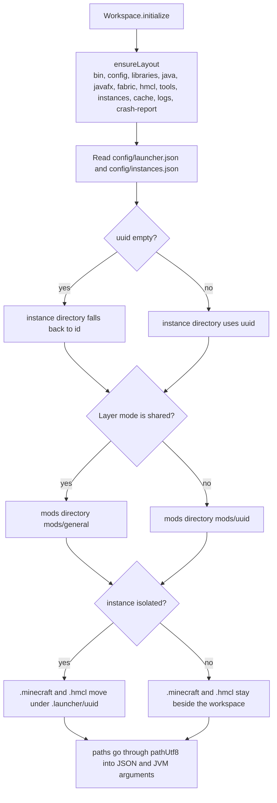

## 17. Installer: download, mirrors, verification, atomic replace, rollback

`installInstance` is a pipeline with a fixed order, and progress percentages map directly to stages:

| Stage | Action | Progress |
|---|---|---|
| Prepare directories | create `profile/<uuid>`, the mods directory, and the Minecraft instance directory | 5 |
| Java | reuse a working path, otherwise detect a local JRE, otherwise download Temurin 21 and extract it | 5 |
| JavaFX | pick 17.0.13, 21.0.13, 22.0.2, 23.0.2, or 24.0.1 by JVM major version; fetch base, graphics, controls win jars | 10-25 |
| Fabric | fetch the profile JSON, write it to disk, then fill in every library | 30-60 |
| HMCL dependencies | Gson, Guava, jsr305, checker-qual, error_prone, and friends | 62-66 |
| HMCL | read version and SHA-1, download to `hmcl/HMCL-<version>.jar` | 75-88 |
| Agent | read version and SHA-256 from metadata, download to a temp file, then rename | 88-93 |
| FLF API | pick the matching version for the HMCL and Agent versions, place it in the instance mods directory | 93-95 |
| FLF Title | optional cosmetic mod, skipped when metadata is unavailable | 96-97 |
| Manifest and validation | write `mclhr.json`, then validate against it | 98-100 |

Data sources are hard-coded, so switching mirrors means changing the base URL:

| Object | Source |
|---|---|
| Vanilla version list | `https://piston-meta.mojang.com/mc/game/version_manifest.json` |
| Fabric Loader list | `https://meta.fabricmc.net/v2/versions/loader/<game version>` |
| Fabric profile | the same address plus `/<loader version>/profile/json` |
| Fabric libraries | the `url` inside the profile, defaulting to `https://maven.fabricmc.net/` |
| Latest HMCL | `https://hmcl.huangyuhui.net/api/update_link?version=0.0&channel=stable`, returning version, jar, jarsha1 |
| HMCL history | the first 40 GitHub Releases, combined with stable/dev/old from `api/download_link` |
| Specific HMCL version | `https://hmcl.glavo.site/download/HMCL-<version>.jar`, which provides no SHA-1 |
| FLF metadata | `https://metadata.hibernet.top/api/metadata`, with `type` set to `flfhmcl`, `flfapi`, or `flftitle` |
| Maven dependencies | `https://repo1.maven.org/maven2/` |
| Java runtime | the Adoptium latest 21 windows x64 jdk binary |

`launcher.json` keeps a `mirrors` field, but the downloader accepts a single URL today, so a mirror takes effect by rewriting the base URL upstream rather than through automatic runtime fallback.

| Step | Verification | Failure handling |
|---|---|---|
| HMCL jar | SHA-1 against `jarsha1` | abort with an error; `repair` deletes and re-downloads |
| Agent jar | `sha_256` from metadata | delete the temp file, keep the old version |
| FLF API and Title | `sha_256` from metadata | delete the freshly downloaded file |
| Shared libraries | record `sha256` and size; on a miss try `.flfhmcl/cache/<sha256>` first | without a cache entry, download from `source` |
| CrashTracker | pinned SHA-256 | warn only when neither the embedded copy nor the Release asset works |

All downloads go through `httpDownload`. It probes chunk support with `Range: bytes=0-0`: when ranges work, the total is at least 4 MiB, and no resumable `.part` exists, four threads take one range each (the status must be 206); otherwise a single stream writes `<target>.part`, and a later run resumes with `Range: bytes=<existing size>-`. Everything ends in `fs::rename(part, dest)`; if an existing target makes the rename fail, the target is removed and the rename retried, so the final path never holds a partial file. A progress callback returning false cancels: the single-stream path deletes `.part`, the chunked path deletes every chunk.

The install pipeline is not transactional. On failure the finished stages survive (Java, verified libraries, the HMCL jar) and a rerun reuses them, so returning to a clean state means deleting the instance directory and installing again. The real rollback lives in modpack import: `cleanupImported` removes the instance directory, the profile, the mods directory, and the isolated directory, so a failure never leaves a half-created instance.

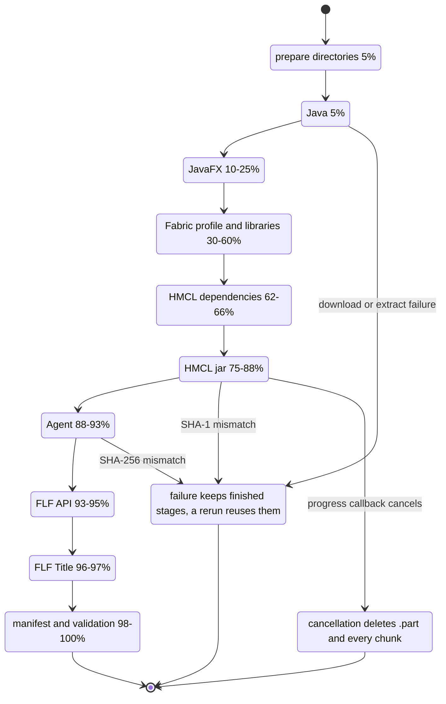

## 18. Launch plan: argument order and code flow

`buildLaunchPlan(instance, quickStart)` produces `LaunchPlan{program, arguments, workingDir, provider}`. `program` is the instance `javaPath`, or the first entry of `detectJava()` when it is empty; `workingDir` is the parent of the Minecraft instance directory; before building it creates the Minecraft instance directory and the HMCL working directory (`.hmcl`) and runs `repairHmclAcl`. `--gameDir` receives the HMCL working directory, which is Fabric's GameDir, not the Minecraft instance directory.

The protocol comes from a `LaunchProvider`; Knot sits before legacy in the list, `supports` picks the first match, and legacy always matches, so it is the fallback. The Knot threshold is `agentVersion >= 2.1.6` (the source comment still says 2.1.5, but the predicate wins).

Common arguments, in this exact order, are identical for every protocol:

| Index | Argument | Value |
|---|---|---|
| 1 | `-javaagent:<path>` | `agentJar(instance)` |
| 2 | `-Dflf.libraries.dir=` | `.flfhmcl/libraries` |
| 3 | `-Dflfhmcl.gameDir=` | Minecraft instance directory (`.minecraft`) |
| 4 | `-Dflf.instance=` | instance id |
| 5 | `-Dflf.loader.version=` | Fabric Loader version |
| 6 | `-Dflf.mclhr.manifest=` | `profile/<uuid>/mclhr.json` |
| 7 | `-Dflf.profile=` | `profile/<uuid>` |
| 8 | `-Dflf.version=` | Agent version |
| 9 | `-Dflf.home=` | `.flfhmcl` root |
| 10 | `-Dflfhmcl.update.managed=true` | constant, disables HMCL self-update |
| 11 | `-Dhmcl.home=` | HMCL working directory (`.hmcl`) |
| 12 | `-Dhmcl.dir=` | same value; HMCL reads both keys |

Protocol tails:

| Protocol | Argument | Meaning |
|---|---|---|
| knot | `-Dflf.knot.direct=true` | declare that Knot starts the runtime directly |
| knot | `-Dfabric.addMods=` | the agent jar plus every jar in `.flfhmcl/mods/<uuid>` sorted by file name, separated by semicolons |
| knot | `-Dflf.hmcl.jar=` | HMCL jar handed to the agent |
| knot | `-cp` and the agent jar | classpath holds the agent only |
| knot | `net.fabricmc.loader.impl.launch.knot.KnotClient` | main class |
| knot | `--gameDir` and the HMCL working directory | `.hmcl`; Fabric's GameDir is the HMCL working directory, not `.minecraft` |
| knot | `--hmclMainClass org.jackhuang.hmcl.Launcher` | HMCL main class |
| legacy | `-jar` and the HMCL jar | older flow, the agent intercepts the entry point |
| both | `--flf-instance=<id>` | appended only when generating a quick-start launcher |

In knot mode Fabric treats `--gameDir` as its working directory, so the mods directory it scans itself is `mods/` under the HMCL working directory (`.hmcl/mods` when not isolated, `.launcher/<uuid>/.hmcl/mods` when isolated); FLF mods and the agent do not go through that scan and are still injected from `.flfhmcl/mods/<uuid>` through `-Dfabric.addMods`.

Code flow:

1. the main window takes the selected instance and writes `profile/<uuid>/instance.json` and `launch.json` when missing;
2. when both the instance and the global config enable pre-launch validation it calls `validateInstanceFiles` and switches to `beginRepair` on failure;
3. when pre-launch update checks are on it compares component versions in the background and only shows a toast, never blocking;
4. `launchInstanceManaged` creates a `CreatePipe`, merges stdout and stderr into one pipe, and starts Java with `CREATE_NEW_PROCESS_GROUP | CREATE_NO_WINDOW`;
5. one thread reads 4096-byte chunks with `ReadFile` and forwards output, another calls `WaitForSingleObject(INFINITE)` and reports the exit code;
6. the main window appends output to `logs/instance-<uuid>.log`, toasts completion when it sees `Loading Done!`, and reports a crash with the latest crash report when the exit code is non-zero or a known failure string appears.

The order is not arbitrary: the JVM parses `-javaagent` and the `-D` options before it decides on a main class, and everything after `-cp` or `-jar` is a game argument; in Knot mode HMCL is loaded by Fabric, so `-Dfabric.addMods` must carry both the agent jar and the instance mods, otherwise only the agent takes effect; `--flf-instance` only appears in quick-start launchers, while a GUI launch keeps the normal HMCL interface. Two lighter entry points exist as well: `launchInstance` fires with `QProcess::startDetached` and returns, and `writeQuickStart` only generates a quick-start launcher without starting a process.

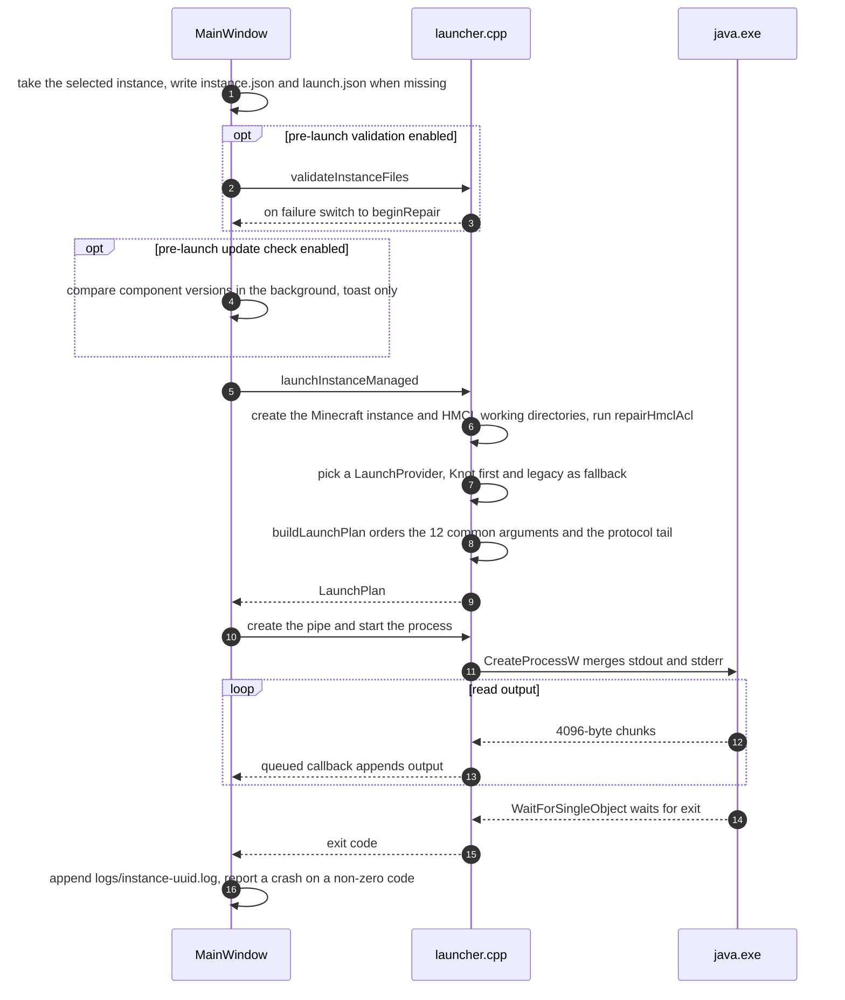

## 19. Quick-start launcher: payload, rescan, quoting, process

The quick-start launcher is a standalone EXE with its configuration appended at the end of the file:

```text
[ original FLFQuickStart.exe ][ JSON config ][ uint64 little-endian length ][ "FLFQS01\n" ]
```

The footer is exactly 16 bytes: the first 8 hold the config length, the last 8 hold the magic. Loading tries the embedded payload first and then a `quickstart.json` sidecar next to the EXE, which is handy for debugging. The config is capped at 64 MiB; a length that exceeds the cap or reaches before the file header marks it invalid.

| Field | Meaning |
|---|---|
| `root` | launcher root; a relative path resolves against the EXE directory |
| `instance` | instance id |
| `modsDir` | mods directory; defaults to `root/.flfhmcl/mods/<instance>` |
| `command` | the full command line captured at generation time, including the Java path and all JVM arguments |
| `workingDir` | working directory for the child process |
| `checkUpdates` and `updateComponents` | update preferences, currently recorded but not executed |
| `baseRoot` | optional; after moving the whole directory it rewrites the old root prefix to the new one |

Generating a launcher: `writeQuickStart` copies `FLFQuickStart.exe` to the target file (renamable), builds a plan with `buildLaunchPlan(instance, true)` so the `--flf-instance` argument is present, joins it with `joinCommand`, and appends it with `appendQuickStartConfig`. When a valid payload already sits at the tail, it first truncates the file back to the original EXE length with `resize_file`, so repeated generation never stacks payloads.

The mods rescan algorithm at run time:

1. parse `command` into argv with `CommandLineToArgvW`;
2. find the first argument starting with `-Dfabric.addMods=`, and take the text after the equals sign up to the first semicolon as the agent path;
3. if the agent is empty, leave the original command alone;
4. scan the mods directory with `directory_iterator` (non-recursive), keeping only regular files with a `.jar` extension, then sort them;
5. rebuild the value as `agent;jar1;jar2` and re-quote every argument with `quoteArg` to form one command line.

Quoting follows the MSVCRT rules: an empty argument becomes a pair of double quotes; quoting is only added for spaces, tabs, or double quotes; backslashes before a quote are doubled, and trailing backslashes are doubled before the closing quote. The rebuilt command line therefore parses back into the same argv through `CommandLineToArgvW`.

Starting and waiting takes four steps: `CreateProcessW(nullptr, command buffer, ..., CREATE_NO_WINDOW, workingDir)`; close `hThread`; `WaitForSingleObject(hProcess, INFINITE)`; read `GetExitCodeProcess` and return the child exit code unchanged. A missing `command` or a failed `CreateProcessW` shows a `MessageBoxW` and returns 1.

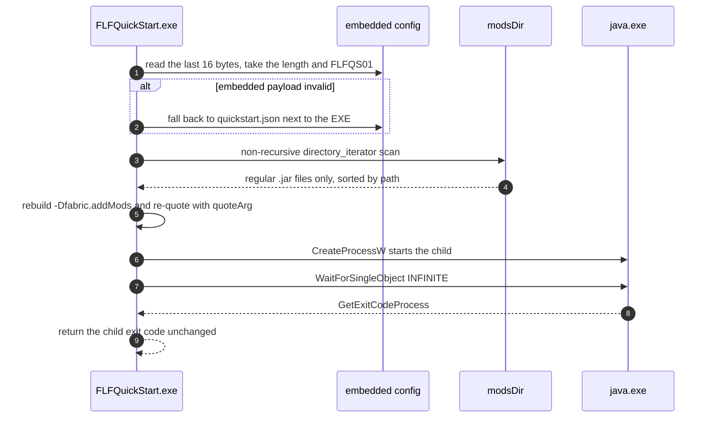

## 20. Modpack format: reading and writing `.flfhmclpack`

A `.flfhmclpack` is a zip with a manifest, not a compressed copy of the instance directory:

```text
pack.zip
├─ flfhmclpack.json
└─ payload/
   ├─ minecraft/   selected files from the Minecraft instance directory
   ├─ hmcl/        filtered HMCL working directory
   ├─ mods/        instance mods
   ├─ profile/     contents of the profile directory
   └─ runtime/     hmcl/HMCL-<version>.jar and agents/FLFHMCL-<version>.jar
```

Manifest fields:

| Field | Contents |
|---|---|
| `format` and `schema` | fixed `flfhmclpack` and `1`, compared exactly on import |
| `generator` | generator name and version (the version is a hard-coded constant today) |
| `name` and `instance` | instance name and the full instance metadata |
| `workspace` | snapshot of the global config |
| `hmclSelection` | whether config, state, cache, and logs are included, and whether tokens are scrubbed |
| `mods` | per-mod path, size, SHA-256, embedded flag, download URL |
| `directories` | empty directories, recreated by role on import |
| `files` | per-file path, role, size, sha256; runtime entries also carry a target |

Export: create a temporary directory, collect files by role and compute SHA-256; filter the HMCL directory by selection (`logs`, `cache`, `config`, and `state` can be excluded), and when scrubbing is on remove JSON keys whose name contains token, password, secret, credential, or session; skip symbolic links so nothing outside the instance is captured; write `flfhmclpack.json`; zip it with the system `tar.exe -a -c -f`; copy the result to the target path. Mods that are not embedded contribute only a URL, which keeps the pack small.

Import: copy the pack into a temporary directory and extract it; verify format and schema; read `instance`, mint a new uuid, and derive a non-conflicting id (appending `-2`, `-3` on conflict); force `isolated` to true and all three layers to private so global directories are never overwritten; create empty directories from `directories`, then write files from `files` after checking SHA-256; place runtime files straight into `.flfhmcl/hmcl/` and `.flfhmcl/agents/`; download link-only mods from `url` and verify them; copy the original manifest to `instances/<uuid>/modpack.json` for provenance; finally register the instance and save the config. Any failure goes through `cleanupImported`.

The safety boundary is `safeRelative`: absolute paths and segments equal to `..` or `.` are rejected, and building `payload/<role>/<relative>` keeps every write inside the role root.

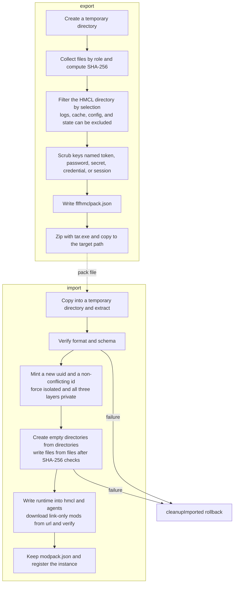

## 21. Qt UI threading model

The UI is plain Qt Widgets, and every long task leaves the main thread through one of two channels:

- `std::thread` plus `QMetaObject::invokeMethod(this, ..., Qt::QueuedConnection)` for install, repair, launch output, and version list loading;
- `QtConcurrent::run` plus a `QFutureWatcher` for one-shot jobs such as modpack import and export.

Stale results are discarded with tokens: `agentToken_`, `hmclToken_`, `fabricToken_`, `apiToken_`, and `updateLoadToken_` increment on every reload or stop, and a worker returns to the main thread with an old token, compares it first, and drops the result when it differs. Dialogs are guarded with `QPointer`, so a closed dialog is never touched again.

Hard rules: a worker never touches a QWidget and never reads mutable containers of `Workspace`; it takes an `Instance` snapshot instead; only `QString`, `QStringList`, and value types cross threads; the output callback of `launchInstanceManaged` also invokes back to the main thread before appending to `runLog_` and to the log file; `QTimer::singleShot(0)` defers a modpack dropped onto the exe, and `singleShot(1500)` deploys CrashTracker on first run.

Launch behavior has three modes, `keep`, `hide`, and `exit`; the instance setting wins and an empty value inherits the global one. All three run only after `launchInstanceManaged` returns success, so a failed start never hides the window.

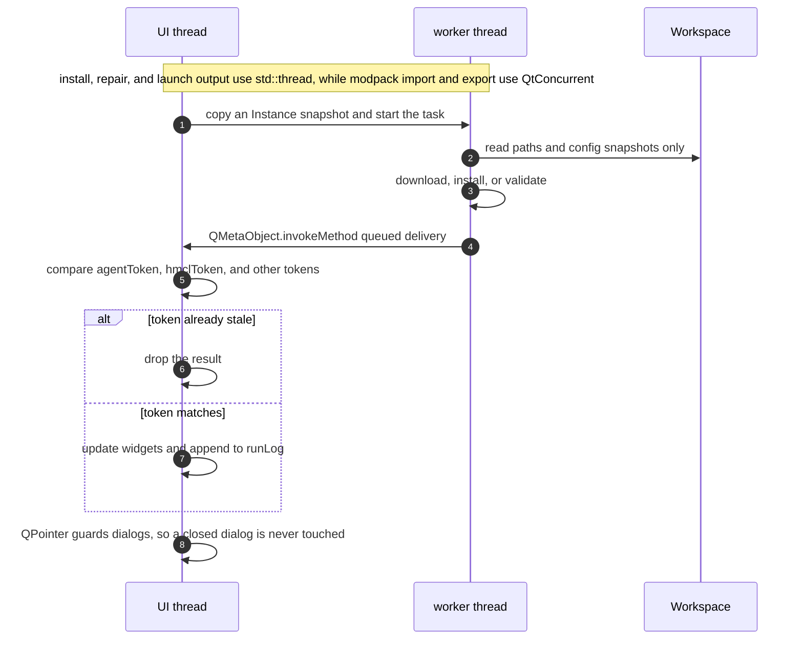

## 22. Logging, CrashTracker, and CLI exit codes

`bootstrap()` builds the directory skeleton, calls `CLogger::Init(.flfhmcl/logs/launcher.log, "flfhmlauncher")`, and writes a startup Info line carrying the workspace root; `shutdown()` writes an exit Info line after the event loop ends. Instance output goes to `.flfhmcl/logs/instance-<uuid>.log`, and crash artifacts land in `.flfhmcl/crash-report/`.

`HiBerCTM` owns crash handling: `InstallCrashHandler(root)`, `SetCrashAppName("FLFHMCLauncher")`, `SetCrashHelpText(...)`, and `InstallCrtReportHook()`. The analysis tool `CrashTracker.exe` is deployed about 1.5 seconds after the first run: it extracts the embedded resource and checks the pinned SHA-256, falls back to the latest GitHub Release asset `CrashTracker_Static.exe`, stores it under `.flfhmcl/tools/CrashTracker/`, hard-links it into `.flfhmcl/bin/` (falling back to a copy when the filesystem refuses hard links), and removes any stale copy from the launcher root.

The CLI entry point is `FLFLauncherCli`; it calls `Workspace::get().initialize()` before dispatching:

| Command | Arguments | Behavior |
|---|---|---|
| `selftest` | none | print version count, Fabric loader count, and HMCL status |
| `install` | instance id, game version, loader version, Java path | run the full install pipeline and save the instance |
| `launch` | instance id | managed launch, then wait for exit |
| `repair` | instance id | repair Java, Agent, HMCL, libraries, and manifest |
| `validate` | instance id | validate files and manifest only |
| `quickstart` | instance id, output exe | generate a quick-start launcher |
| `export-pack` | instance id, output pack | export a modpack |
| `import-pack` | pack path | import a modpack |

Exit codes are what scripts rely on:

| Code | Meaning |
|---|---|
| 0 | success |
| 1 | usage error: unknown subcommand or too few arguments, usage is printed |
| 2 | instance not found, or no Fabric loader available |
| 3 | operation failed: install, repair, validation, pack import or export, quick-start writing, or starting Java |
| 4 | `launch` started but the Java child exited with a non-zero code |

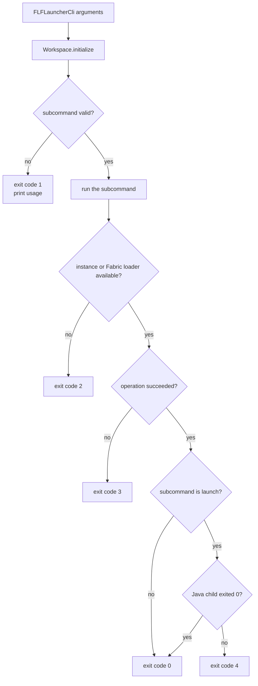

## 23. CMake, build, and release

Toolchain: CMake 3.25 or newer, C++20, MSVC 2022, static Qt 6.11.1, vcpkg `x64-windows`, Ninja. MSVC always gets `/utf-8 /permissive-`, otherwise non-ASCII comments and string literals are parsed through the GBK code page and break.

| Option | Default | Effect |
|---|---|---|
| `FLF_ENABLE_HIBERGUI` | ON | link HiBerGUILibrary, needs nlohmann-json |
| `FLF_ENABLE_WEBVIEW2` | OFF | build the WebView2 component, needs the vcpkg webview2 port |
| `FLF_BUILD_QUICKSTART` | ON | build the Qt-free quick-start launcher |
| `FLF_BUILD_EXAMPLES` | OFF | build the examples |

One command builds and packages:

```powershell
pwsh -NoProfile -File scripts\build.ps1
```

The script takes `-QtRoot`, `-VcpkgRoot`, `-BuildDir`, `-Triplet`, and `-VcVars`; it runs `vcvars64.bat`, configures, builds, and finally runs `package-release`. The manual equivalent:

```powershell
call "F:\Program Files\Microsoft Visual Studio\18\Community\VC\Auxiliary\Build\vcvars64.bat"
cmake -B build -S . -G Ninja -DCMAKE_BUILD_TYPE=Release `
  -DCMAKE_PREFIX_PATH="H:/Qt-static/6.11.1/msvc2022_64" `
  -DCMAKE_TOOLCHAIN_FILE="H:/vcpkg/scripts/buildsystems/vcpkg.cmake" `
  -DVCPKG_TARGET_TRIPLET=x64-windows
cmake --build build --config Release
cmake --build build --target package-release
```

`package-release` is a custom target that depends on the bootstrap, the GUI, and the quick-start launcher, and it runs `scripts/package-release.ps1 -BuildDir`: it checks `FLFHMCLauncherBootstrap.exe`, `FLFHMCLauncherApp.exe`, `FLFQuickStart.exe`, `spdlog.dll`, and the icon; finds the newest VC Redist through `vswhere` and picks `msvcp140*` and `vcruntime140*`; then writes the single-file EXE following the footer layout. Pull the submodules first with `git submodule update --init --recursive` (HiBerGUILibCPP, CommonLoggerCPP, CrashTrackerHandleLibCPP). The install rules ship only the release EXE and `flfhmclpack.ico`; the rest of the tree is created on first run.

Minimal post-build check: run `build\FLFHMCLauncher.exe` and confirm `.flfhmcl/bin` appears and the GUI opens; then run `build\FLFLauncherCli.exe selftest` and confirm the metadata sources are reachable.

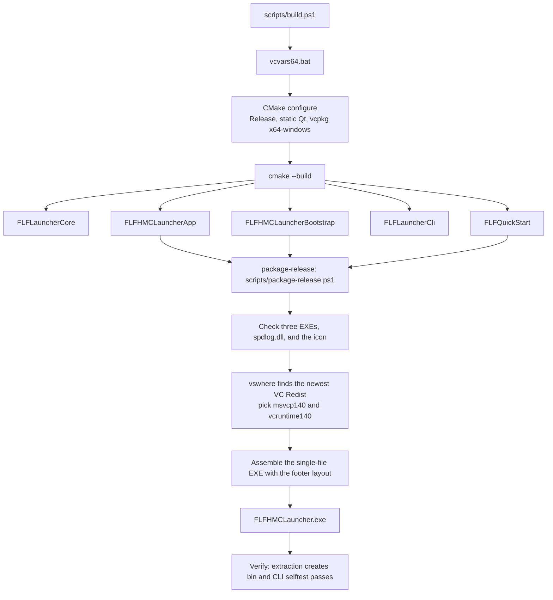

## 24. Test matrix

| # | Scenario | Steps | Pass criteria |
|---|---|---|---|
| 1 | First extraction | delete `.flfhmcl/bin`, run the release EXE | all payload files and the `.payload` marker appear, the GUI starts |
| 2 | Payload update | overwrite the EXE with a new build, run again | files are extracted again and the GUI version changes |
| 3 | Corrupt payload | truncate the EXE tail or break the footer magic | no silent start; falls back to an existing app, otherwise shows an error box |
| 4 | Non-ASCII and spaced paths | put the whole directory under a path with non-ASCII characters and spaces | extraction, launch, and log paths all work without garbling |
| 5 | CLI self-test | `FLFLauncherCli selftest` | prints versions and Fabric count, exit code 0 |
| 6 | CLI exit codes | run `launch` and `validate` against a missing instance | stderr explains the reason, exit code 2 |
| 7 | Install and repair | run `install` in an empty workspace, delete a few libraries, run `repair` | progress reaches 100, `validate` passes, missing libraries return |
| 8 | Mods rescan | generate a quick-start launcher, add and remove jars, run it | the effective `-Dfabric.addMods` reflects the current list |
| 9 | Quick-start exit | open the generated EXE, close HMCL normally | both Java and the launcher exit, the exit code is forwarded |
| 10 | Modpack round trip | export, then import in another directory | new uuid, forced isolation, every SHA-256 passes, failures roll back cleanly |
| 11 | Overwrite upgrade | drop a new EXE over an old version directory | instances and config survive, `.flfhmcl` is not wiped |
| 12 | Crash reporting | provoke a Java crash | a report lands in `crash-report`, `launcher.log` records it, the UI reports the crash |

## 25. Pitfalls

| # | Symptom | Cause | Fix |
|---|---|---|---|
| 1 | jars added to the mods directory have no effect | generation freezes the `-Dfabric.addMods` snapshot into the command line | rescan the mods directory and rebuild that argument on every start |
| 2 | Java keeps running after HMCL closes | a non-daemon thread survives in the child process | host the process from the launcher, wait for exit, clean up by PID when it hangs |
| 3 | an instance breaks after an overwrite upgrade | a new EXE is mixed with an old `bin`, so component versions diverge | let the `.payload` marker trigger extraction, and back up `.flfhmcl` before upgrading |
| 4 | a pack stops working on another machine | the payload records the absolute `root` and `command` from generation time | prefer a relative root on the writing side, or add `baseRoot` so the prefix is rewritten |
| 5 | disk usage grows after cancelling downloads | leftover `.part` files and chunks are never cleaned | delete `.part` and every chunk on the cancel path |
| 6 | JVM arguments are garbled on non-ASCII paths | `path::string()` returns the ANSI code page | always go through `pathUtf8` and `pathFromUtf8` |
| 7 | a mods group is set but no grouped directory appears | `resolveMods` only distinguishes shared from private, `group` never participates | set `mode` to shared and agree on the shared directory when grouping is needed |
| 8 | overwriting the EXE fails while the GUI runs | `MoveFileExW` hits mapped PE images and DLLs | exit the GUI first; the bootstrap tolerates a failed extraction and starts the old app |
| 9 | the quick-start EXE grows on every regeneration | payloads keep appending | truncate the old payload using the tail length before appending |
| 10 | HMCL initialization hangs or is skipped | an inherited Everyone deny ACL makes the writability check fail | remove the deny entry with `icacls` and grant the current user full control before launch |
| 11 | random UI crashes or crossed data | a worker touches widgets or mutable containers directly | change UI only on the main thread, pass value types and snapshots, drop stale results by token |
| 12 | classpath conflicts at launch | the mclhr manifest mixes several fabric-loader versions or a JavaFX version that does not match | filter by instance version and deduplicate when writing, reject duplicate libraries during validation |

> External business components are outside this page; the launcher provides generic platform capabilities only.
