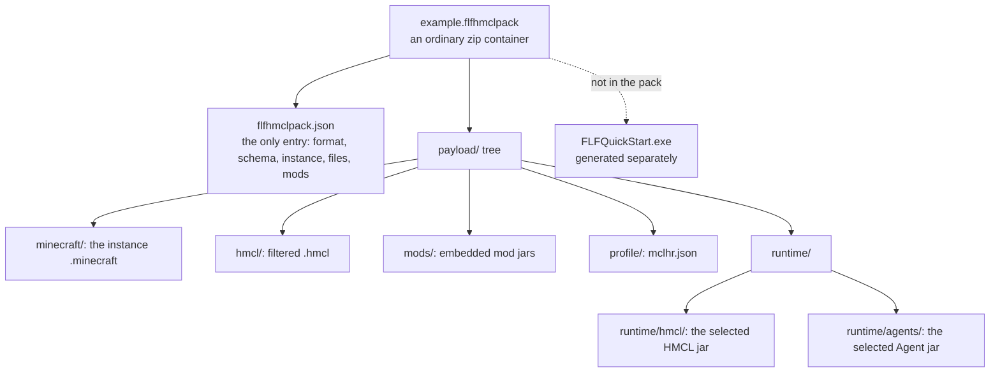
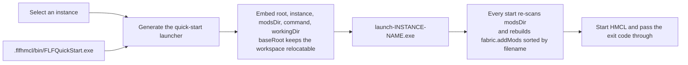
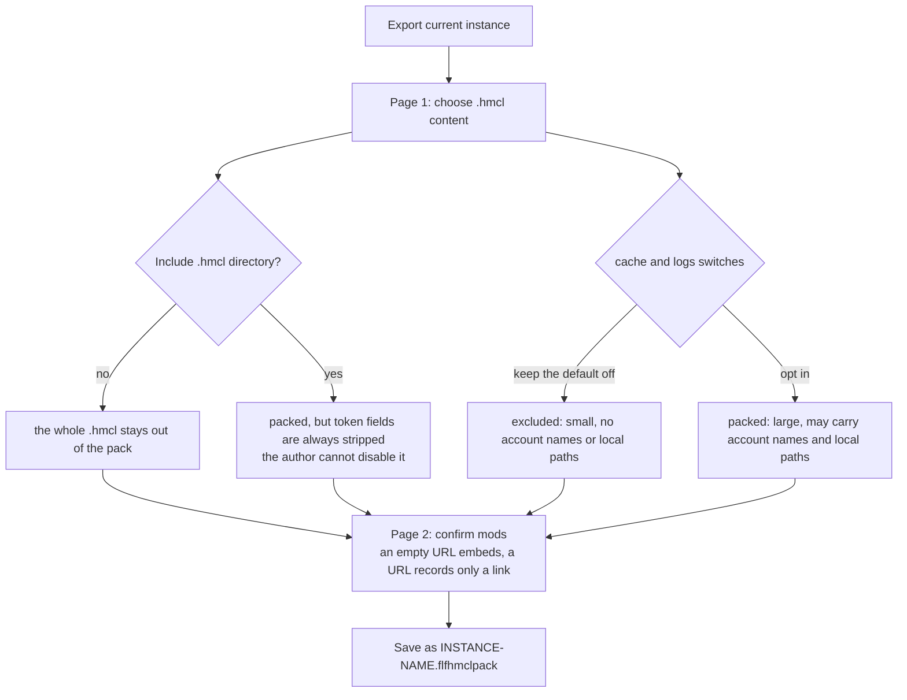
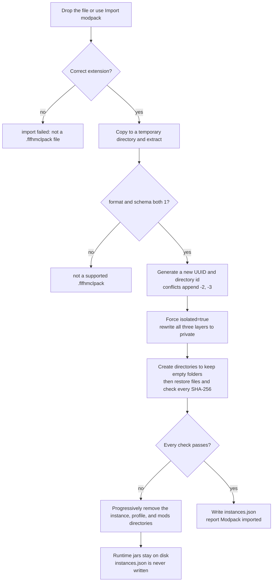
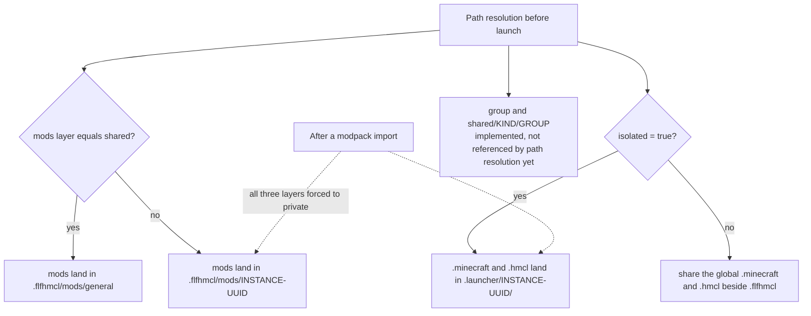
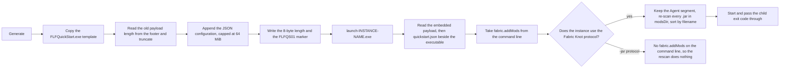
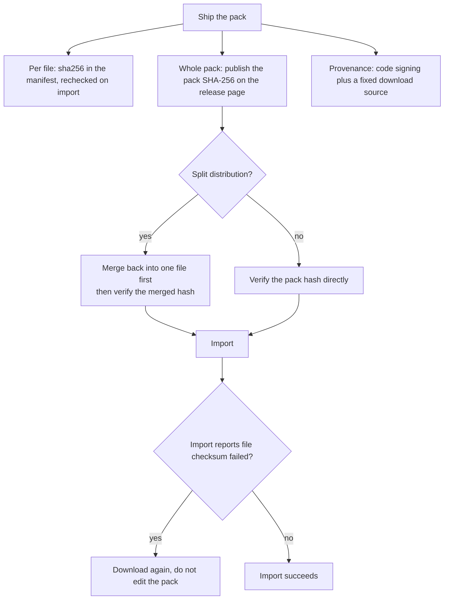

FLFHMCLauncher's modpack format is `.flfhmclpack`. It is not a plain zip: besides instance files it records versions, layer isolation, components, and launch information. This page covers export, distribution, import, and testing.



## 1. What the pack contains

A usable pack usually contains:

- instance metadata (HMCL, Fabric, Java, Agent, FLF API versions);
- the `.minecraft` game version, configuration, and mods;
- `.hmcl` launcher configuration;
- layer isolation settings;
- an optional quick-start launcher.

It does not contain: user account tokens, personal saves (unless explicitly selected), logs, or caches.

## 2. Export

1. Select an instance.
2. Choose "Export modpack".
3. Select the contents.
4. Decide whether to include user data.
5. Generate the `.flfhmclpack`.
6. Verify size and SHA-256.

Before exporting, remove:

- test mods;
- old logs;
- temporary files;
- account information unrelated to the pack.

## 3. Import and overwrite

On import the launcher:

- validates format and version;
- creates or selects an instance;
- writes files according to the layer policy;
- preserves user mods when the pack allows it;
- rolls back on failure.

Back up before an overwrite install. Do not assume import replaces every file; follow the pack metadata.

## 4. Instance layout

```text
<instance>/
├─ .minecraft/       game and mods
├─ .hmcl/            HMCL configuration
├─ profile/          launch configuration
├─ logs/             logs
└─ crash-report/     crash reports
```

Layer isolation maps these directories to private, shared, or group locations.

## 5. Layer isolation

| Mode | Use | Note |
|---|---|---|
| Private | Single independent instance | Larger, simplest upgrade |
| Shared | Multiple instances share game/mods | Handle mod conflicts |
| Group | Instances in one group share | Keep group config consistent |

Recommended: private by default; use shared/group only when multiple versions need common resources.

## 6. Platform and API packaging

- ship a matching FLFHMCL Agent;
- ship FLF API core and required submodules;
- do not shade API classes into business jars;
- exclude test mods;
- record versions in metadata for upgrades.

## 7. Quick-start distribution

A quick-start launcher can ship with the pack:

- generation embeds instance id, root, modsDir, and launch command;
- it re-scans modsDir at runtime, so added/removed mods apply automatically;
- icon and filename are customizable;
- the process should exit after HMCL closes;
- never hard-code absolute paths from another machine.



## 8. Versions and upgrades

- external version: pack version;
- internal versions: HMCL/Fabric/Agent/FLF API;
- document the compatibility range for upgrades;
- downgrades may not accept newer configuration, so back up first;
- do not confuse the pack version with the four-part FLF API version.

## 9. Distribution

- publish SHA-256;
- split/compress large packs;
- document installation on the release page;
- sign when required;
- state whether Java must be downloaded separately.

## 10. Test matrix

| Scenario | Check |
|---|---|
| Fresh install | Starts and reaches the main window |
| Overwrite upgrade | User mods/saves preserved |
| Moved directory | Quick-start and paths still work |
| Chinese path | Extraction, launch, mod loading work |
| Offline | Cached dependencies allow startup |
| HMCL version mismatch | Clear error |
| Quick-start | Mod add/remove applies, exits after close |
| Metadata schema mismatch | Rejected, no half-created instance |
| Link-only mod offline | Download error, retry works once online |
| Empty folders | Directories still exist after import |
| Two packs with one id | Suffix added, neither overwrites the other |
| Runtime jars | Shared HMCL and Agent jars still launch |

## 11. Troubleshooting

| Symptom | Cause | Action |
|---|---|---|
| Import fails | Corrupt pack/unsupported version | Verify SHA-256, update launcher |
| Missing Agent at startup | Not packaged or wrong path | Check metadata and directories |
| Quick-start loads old mods | Old template without rescan | Regenerate with current launcher |
| Lingering process | HMCL did not exit | Update Agent, inspect threads |
| Chinese path failure | Old encoding issue | Upgrade to current version |
| Import reports `modpack manifest is corrupt: X` | Manifest truncated or hand-edited | Re-export, never edit the JSON by hand |
| Import reports `file checksum failed: X` | File changed or transfer incomplete | Re-download and verify the pack hash |
| Import reports `runtime file path is invalid: X` | `target` field edited by hand | Re-export, do not edit runtime entries |
| Quick-start reports `no embedded quick-start configuration found, and no quickstart.json beside the executable: X` | Executable replaced or payload wiped | Regenerate with the current version, or drop a `quickstart.json` beside it |
| Startup validation reports `mclhr manifest pins a wrong Fabric Loader version` | Instance loader version differs from the manifest | Repair or reinstall the instance, then export from it |

Messages above come from `modpack.cpp`, `quickstart_config.cpp`, and `launcher.cpp`; the wording is localized by the interface language while identifiers stay verbatim.

## 12. Archive layout and metadata fields

Export first builds the manifest and the `payload/` tree in a temporary directory, then packs them into a zip container with the system `tar.exe` and writes the result to the target path. `.flfhmclpack` is only an extension: the container is an ordinary zip, so you can unpack it to inspect, but an unpacked directory is not a runnable instance. Note that INSTANCE-UUID below stands for the instance UUID.

| Path inside the archive | Content | Written when |
|---|---|---|
| `flfhmclpack.json` | Whole-pack manifest, the only entry point | Always |
| `payload/minecraft/` | The instance `.minecraft` tree | Instance has a game directory |
| `payload/hmcl/` | Filtered `.hmcl` tree | "Include .hmcl directory" is checked |
| `payload/mods/` | Loose mod jars | That mod is embedded |
| `payload/profile/` | `mclhr.json` and other launch configuration | Instance has a profile directory |
| `payload/runtime/hmcl/` | The selected HMCL jar | Runtime is included |
| `payload/runtime/agents/` | The selected Agent jar | Runtime is included |

Fields of `flfhmclpack.json`:

| Field | Type | Meaning |
|---|---|---|
| `format` | string | Fixed `flfhmclpack`; any other value is rejected |
| `schema` | integer | Currently `1`; the importer accepts `1` only |
| `generator` | object | `name` and `version`; the source matching this page writes `0.3.10` |
| `createdAt` | integer | Export time in Unix seconds |
| `name` | string | Display name of the pack, reused as the instance name |
| `instance` | object | Full instance metadata, same shape as `instances.json` |
| `workspace` | object | `schema`, `hmclVersion`, `agentJar`, `launchBehavior`, and the two launch switches |
| `hmclSelection` | object | Five switches: `config`, `state`, `cache`, `logs`, `sanitizeTokens` |
| `includeMinecraftLogs` | boolean | Whether `logs` and `crash-reports` are packed |
| `directories` | array | Each item has `path` and `role`, used to restore empty folders |
| `files` | array | Each item has `path`, `role`, `size`, `sha256`; runtime entries also have `target` |
| `mods` | array | Each item has `path`, `role`, `file`, `size`, `sha256`, `embedded`, `url` |

The `role` of a `files[]` entry decides where it lands:

| `role` | Landing place |
|---|---|
| `minecraft` | The instance `.minecraft` |
| `hmcl` | The instance `.hmcl` |
| `mods` | The instance's own mods directory |
| `profile` | `.flfhmcl/profile/INSTANCE-UUID/` |
| `runtime` | Back to `.flfhmcl/hmcl/` or `.flfhmcl/agents/` according to `target` |

The manifest is two-space indented JSON. Missing fields are filled with defaults on import: `loader` falls back to `fabric`, both launch switches fall back to `true`, and an empty `updateComponents` is refilled with `hmcl`, `flfapi`, `agent`, `fabric`, `launcher`. `instance.id` and `instance.uuid` are only a snapshot from export time; import generates them again.

## 13. Export wizard, step by step

1. Select the target instance in the list and click "Export current instance" in the left menu; with nothing selected it reports `export failed: select an instance first`.
2. Page 1 is "Choose .hmcl content"; its subtitle states that account tokens are removed and that logs and caches are excluded by default. The switches are listed below.
3. Page 2 is "Confirm mods": one row per jar. Leaving the download URL empty embeds the jar, filling it records only a link. You can go straight to the next step; everything defaults to embedded.
4. Clicking "Export" opens the save dialog. The suggested name is the instance name plus `.flfhmclpack`, and a missing extension is appended automatically.
5. Export runs on a background thread, shows "Exporting modpack..." without a cancel button, then reports "Modpack exported" with the filename and file count.
6. Note the file size afterwards and compute the whole-pack hash as described in section 20.

| Option | Default | Effect |
|---|---|---|
| Include .hmcl directory | on | Off keeps the whole `.hmcl` out of the pack |
| config (accounts, download sources, launcher settings) | on | Packed; token fields inside are stripped |
| state (window and user state) | on | Packed; tiny |
| cache | off | Large; re-downloaded after import |
| logs | off | May contain account names and local paths |
| Include .minecraft/logs and crash-reports | off | Affects those two folders under the game directory; logs often carry account names and local paths |

Always excluded: `libraries`, `java`, `cache`, `logs`, `bin` under `.flfhmcl`, plus the launcher itself; the launcher restores them from metadata. The quick-start launcher is not in the pack either and must be generated separately.

Possible export failures: `cannot create a temporary directory`, `cannot start tar.exe`, `tar.exe failed: X`, `cannot compute SHA-256: X`, `failed to write the modpack: X`. For the first two, check that the temporary directory is writable and that the system `tar.exe` is on `PATH`.



## 14. User data and token cleanup

The hint on wizard page 1 stands for three fixed rules the author cannot disable:

- Token cleanup is always on. `.hmcl` is first copied to a temporary directory, every `.json` file is parsed, sensitive keys are dropped, and only then is the tree packed.
- Key matching is case-insensitive. A key containing `token`, `password`, `secret`, `credential`, or `session` is removed entirely, and nested objects and arrays are processed recursively.
- Files that are not JSON, or that fail to parse, are kept as-is, so plain-text credentials inside non-JSON files are not cleaned.

Three boundaries matter: only `.json` files under `.hmcl` are processed, so skin-site configuration under `.minecraft` and account names in `options.txt` are untouched; the `saves/` directory lives under `.minecraft` and ships by default, so move saves out of the instance when they must not travel; cleanup removes keys but not files, so empty objects may remain.

`.minecraft/logs` and `crash-reports` are a separate switch: the whole folder is skipped unless checked.

## 15. Import, overwrite, and rollback semantics

There are two entry points: drop the file onto the window, or use "Import modpack" in the left menu. A wrong extension reports `import failed: not a .flfhmclpack file` immediately.

The order is fixed:

1. The pack is copied to a temporary directory and extracted, then `flfhmclpack.json` is read; a missing file reports `modpack manifest not found: X`, a broken one reports `modpack manifest is corrupt: X`.
2. `format` and `schema` are validated; a mismatch reports `not a supported .flfhmclpack (format/schema mismatch)`; missing metadata reports `modpack has no instance metadata`.
3. A new UUID and a new directory id are generated: the packed `id` keeps only letters, digits, hyphens, and underscores, other characters collapse into one hyphen, and an empty result becomes `imported-pack`. Conflicts with existing ids append `-2`, `-3`, and so on.
4. `isolated=true` is forced and the `mods`, `minecraft`, and `hmclHome` layers are all rewritten to `private`; layer modes recorded in the pack do not apply here.
5. Directories listed in `directories` are created first so empty folders survive, then files are restored from `files` and every SHA-256 is checked; a missing file reports `modpack is missing file: X`, a mismatch reports `file checksum failed: X`.
6. Runtime entries are written back into `hmcl` or `agents` under `.flfhmcl` according to `target`; an invalid `target` reports `runtime file path is invalid: X`.
7. Link-only mods are downloaded into the instance mods directory; a missing URL reports `mod is not embedded and has no download URL: X`, a failed download reports `mod download failed: X`, a hash mismatch reports `mod checksum failed: X`.
8. The manifest is stored again as `modpack.json` inside the instance directory for provenance and re-export.
9. `instances.json` is written, the last-instance pointer moves to the new instance, the UI switches to the instance page and reports "Modpack imported - N files".

| Case | Behaviour |
|---|---|
| An instance with the same id exists | A suffixed id is created; the old instance is untouched |
| `.minecraft` inside the pack | Written to the private instance directory, global `.minecraft` untouched |
| A file already exists | Later writes win inside that instance; isolation keeps other instances safe |
| `runtime` jars | Overwrite same-named files under `hmcl` and `agents` in `.flfhmcl` |
| `instances.json` | Written only after every check passes |

Rollback: any failure progressively removes the instance directory, the profile directory, and the mods directory, and for isolated instances drops the whole `.launcher/INSTANCE-UUID` tree before reporting "Import failed". Two things are not rolled back: runtime jars already copied into `hmcl` and `agents` stay on disk, and `instances.json` is never written, so no half entry is left behind. Retrying is safe; only the runtime jars need manual care.



## 16. Instance and layer directory reference

| Concept | Location on disk | Note |
|---|---|---|
| Workspace root | `.flfhmcl/` beside the launcher executable | From `FLFHMCL_LAUNCHER_DIR` or the executable directory |
| Instance records | `.flfhmcl/config/instances.json` | One entry per instance with UUID, versions, layer modes |
| Launcher configuration | `.flfhmcl/config/launcher.json` | HMCL version, Agent path, last instance |
| Instance directory | `.flfhmcl/instances/INSTANCE-UUID/` | Instance extras and `modpack.json` |
| Launch configuration | `.flfhmcl/profile/INSTANCE-UUID/` | The `mclhr.json` manifest |
| Private mods | `.flfhmcl/mods/INSTANCE-UUID/` | Default location, also holds the FLF API jar |
| Shared mods | `.flfhmcl/mods/general/` | Used when the layer mode is `shared` |
| Shared directory | `.flfhmcl/shared/KIND/GROUP/` | Landing zone for group mode, group names are sanitized |
| Isolated game directory | `.launcher/INSTANCE-UUID/.minecraft/` | Used when `isolated=true` |
| Isolated launcher directory | `.launcher/INSTANCE-UUID/.hmcl/` | Same condition |
| Runtime | `bin`, `hmcl`, `agents`, `fabric`, `java`, `javafx`, `libraries` under `.flfhmcl` | Shared by all instances |
| Launcher log | `.flfhmcl/logs/launcher.log` | First stop when debugging |

Layer resolution follows the current implementation: `mods` lands in `.flfhmcl/mods/general` only when the mode is `shared`, and in the private instance directory otherwise; `minecraft` and `hmclHome` look at `isolated` alone, going under `.launcher/INSTANCE-UUID/` when isolated and sharing the global `.minecraft` and `.hmcl` beside `.flfhmcl` otherwise. The `group` value and the `shared/KIND/GROUP` directory exist but are not referenced by path resolution yet. After import all three layers are `private`.



## 17. Platform, Agent, and FLF API packaging

The pack carries only two runtime jars, HMCL and Agent, both shared across instances. FLF API is a mod and belongs in the instance's own mods directory.

| Component | Expected location | Message when missing or wrong |
|---|---|---|
| HMCL | `.flfhmcl/hmcl/HMCL-VERSION.jar`, falling back to `HMCL.jar` when the instance records no version | `HMCL jar does not exist`, `HMCL.jar does not exist; install the instance first` |
| Agent | `.flfhmcl/agents/FLFHMCL-VERSION.jar`, otherwise the configured `agentJar` or `FLFHMCL-agent.jar` beside the launcher | `FLFHMCL Agent does not exist`, `FLFHMCL-agent.jar does not exist` |
| FLF API | `flf-api-VERSION.jar` in the instance mods directory | Skipped when metadata is unavailable, launch continues |
| Fabric Loader | `.flfhmcl/fabric/GAME-VERSION/LOADER-VERSION/` | `mclhr manifest pins a wrong Fabric Loader version` |

How FLF API is chosen: when the instance `flfApiVersion` is empty, the launcher picks the first release whose HMCL versions include the instance HMCL version and whose `>=` Agent requirements are satisfied; `none` means skip and also removes other `flf-api-` jars from the mods directory. Installing a newer version removes other `flf-api-` jars and legacy-named ones too, avoiding duplicate classes and double registration. Never shade these jars into business mods.

There are two launch protocols; the only threshold worth remembering is `2.1.6`. With Agent `2.1.6` or newer the launcher starts Fabric Knot directly and puts the Agent plus the instance mod jars into `fabric.addMods`; below that it falls back to `-jar` and lets the Agent intercept the entry point. Both pass the instance id, game directory, loader version, manifest path, profile directory, and workspace root.

Validation before launch is on by default and checks Java, the Agent, the HMCL jar with its SHA-1, `mclhr.json` with its SHA-256, library entries, and the Fabric Loader version. Messages include `Java path does not exist`, `mclhr manifest hash mismatch`, `mclhr manifest contains a duplicate library: X`, `mclhr manifest failed to parse: X`. Shipping those hashes is safer, but hand-editing instance metadata blocks the launch immediately.

## 18. Quick-start payload, mod rescan, and limits

Generation appends configuration to a copy of `FLFQuickStart.exe`, so regenerating only replaces the tail payload. The last 16 bytes of the file are a footer:

```text
[JSON configuration][8-byte little-endian length][8-byte marker FLFQS01 plus newline]
```

- The JSON is capped at 64 MiB; a zero length or a length beyond the file size is treated as invalid.
- Regeneration reads the old payload length from the footer, truncates it, then appends the new payload, so repeated generation never grows the file without bound.
- Loading looks for the embedded payload first, then for a `quickstart.json` beside the executable; neither present reports `no embedded quick-start configuration found, and no quickstart.json beside the executable: X`.
- A configuration without `root` or `instance` reports `quick-start configuration is missing root` or `quick-start configuration is missing instance`; a missing `command` shows `quick-start configuration is missing command:` together with the instance id.

Configuration fields: `root` (workspace root), `instance` (instance id), `modsDir` (mods directory), `command` (full launch command line), `workingDir` (working directory), plus the update-check fields used before launch. A hidden `baseRoot` field supports relocation: when the resolved `root` differs from it, old prefixes inside `command` and `workingDir` are rewritten to the local path, so the whole workspace can be moved.

The mod rescan is the core mechanism: every start parses the command line, takes the value of `fabric.addMods`, keeps the first segment (the Agent path), lists every `.jar` in the current `modsDir`, sorts by filename, and rebuilds the value. Players can add or remove jars without regenerating, the next start picks it up, and jars already deleted are not loaded.

Limits and caveats:

- Windows executables only; generation copies the template from `.flfhmcl/bin/FLFQuickStart.exe` and falls back to the launcher directory.
- The rescan only rewrites `fabric.addMods`. If the instance uses the `-jar` protocol, that argument does not exist and the rescan does nothing, so repairing or reinstalling the instance is the way to change mods.
- `modsDir` is fixed at generation time. When the workspace moves to another machine with a different layout it may point at an empty directory; `command` and `workingDir` survive through `baseRoot`, `modsDir` does not.
- The command line is frozen, so a different instance, a different Java, or different launch arguments all require regenerating. The quick-start window does not stay resident; the child exit code is passed through and the process ends when HMCL closes.

Icon and filename: the default filename is `launch-` plus the instance name, Windows-illegal characters and control characters become underscores, trailing dots and spaces are trimmed, and an empty result falls back to `instance`. Generation does not write an icon, so the template executable's icon is the final icon; replacing it means replacing the template resource before distribution. The `.flfhmclpack` file icon (`assets/modpack/flfhmclpack.ico`, resource id `102` in release builds) only serves file association and is unrelated to the quick-start icon.



## 19. Versions, upgrades, and downgrades

A pack carries two kinds of versions and they must be kept apart:

- external version: the pack's own version, chosen by the author, written on the release page and in the filename;
- internal versions: game version, loader version, HMCL version, Agent version, and FLF API version inside `instance`, plus `workspace.schema` and `generator.version`.

The FLF API version has four parts, shaped like FLFAPI major.minor.FLFHMCL major.HMCL minor, and must not be mixed up with the pack version. Legacy three-part names with suffixes are migrated into four parts when the instance is read, so authors do not need to edit them.

| Action | Result | Note |
|---|---|---|
| Reinstall with the same schema | A new instance, the old one stays | No in-place overwrite, user saves do not move along |
| Older launcher reads a newer schema | Rejected with a format/schema mismatch message | State the minimum launcher version when shipping a new schema |
| Newer launcher reads an older pack | Missing fields default, import succeeds | Missing layer modes fall back to `private` |
| Hand-editing a file in the pack | `file checksum failed: X` on import | Re-export instead of editing the zip |
| Downgrading to an older launcher | New fields may be unknown or rejected | Back up the workspace and tell players to do the same |

Upgrade advice: keep `schema` stable, put changes into `instance` and `mods`, and bump `schema` only for real format changes. Verify a release by importing it as a new instance instead of testing on top of an existing one. Downgrades are not guaranteed to work, especially around pre-launch update checks and layer-mode defaults, so copy `.flfhmcl` before rolling back.

## 20. Distribution, checksums, and signing

Export writes a SHA-256 for every file and import rechecks each of them; that is in-pack integrity. It does not stop a full repack (files and hashes can be changed together) or a truncated transfer. Distribution therefore needs a whole-pack checksum and a signature for provenance.

| Level | Method | Coverage |
|---|---|---|
| Per file | `sha256` in the manifest, rechecked on import | Every file in the pack |
| Whole pack | Compute one SHA-256 at release time and publish it | The entire `.flfhmclpack` |
| Provenance | Code signing plus a fixed download source | Launcher executable and release artifacts |

Suggested release flow:

1. Note file size and file count; the success toast already shows the file count.
2. Compute the whole-pack hash with `Get-FileHash -Algorithm SHA256 .\example.flfhmclpack` and publish it next to the download link.
3. Split and compress large packs, publish the merge command and the hash of the merged file; split parts are not `.flfhmclpack` files, so players must merge them first.
4. Sign when provenance matters: sign the launcher and the release package with a code-signing certificate and publish the certificate thumbprint. Publishing only a hash proves the file is intact, not who made it.
5. State the Java requirement, whether Java must be downloaded separately, whether a quick-start launcher ships with the pack, and which directories appear on first launch.

Self-check for players: compare the whole-pack hash before importing. A `file checksum failed: X` during import means the file changed or the download is incomplete, so download again instead of editing the pack.



> External business components are outside this page; packs declare dependencies and link to their documentation.
