FLFHMCLauncher 是 FLFHMCL 的外壳，使用 C++ / 静态 Qt 实现。它不是 Java 运行时，也不负责 Fabric 类加载；它负责把实例、组件、命令、更新和进程生命周期管理起来。

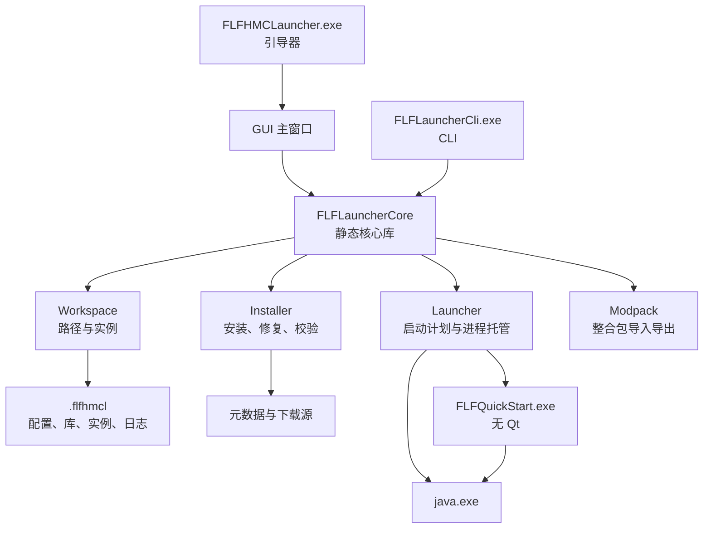

## 一、设计目标

- 单文件 EXE，减少运行库依赖；
- 静态 Qt，避免用户安装 Qt；
- 所有路径支持中文；
- 实例隔离、共享库、快速启动；
- 失败可诊断，不静默崩溃；
- 与 FLFHMCL/mclhr 解耦：只消费它们的产物。

## 二、模块

```text
src/
├─ bootstrap_main.cpp     自解压/引导
├─ cli_main.cpp           CLI
├─ quickstart_main.cpp    快速启动器
├─ main.cpp               GUI 入口
├─ core/
│  ├─ workspace.*         工作区/实例
│  ├─ installer.*         安装/下载/校验
│  ├─ launcher.*          启动计划/快速启动
│  ├─ modpack.*           .flfhmclpack
│  ├─ quickstart_config.* 内嵌配置
│  ├─ meta.*              元数据
│  ├─ http.*              WinHTTP
│  └─ mods.*              模组扫描
└─ ui/mainwindow.*        Qt 界面
```

## 三、bootstrap

发布版 `FLFHMCLauncher.exe` 在自身尾部附带 GUI、QuickStart、DLL 和资源。首次运行：

1. 读取 payload；
2. 释放到 `.flfhmcl/bin`；
3. 校验版本；
4. 启动 GUI。

引导器本身使用 `/MT`，只依赖 Windows 系统 DLL。

## 四、工作区

`Workspace` 负责：

- 定位 `.flfhmcl`；
- 读取配置与实例列表；
- 解析 profile、`.minecraft`、`.hmcl`；
- 解析模组、库、Agent、HMCL 路径。

所有路径以 UTF-8 写入 JSON/JVM 参数，避免中文路径乱码。

## 五、安装器

安装器负责：

- 拉取元数据；
- 选择镜像；
- 下载；
- SHA-1/SHA-256 校验；
- 原子替换；
- 失败回滚。

长任务应支持取消；取消后删除临时文件，不破坏现有实例。

## 六、启动计划

`buildLaunchPlan` 生成：

- Java 可执行文件；
- `-javaagent` Agent；
- `-Dflf.*` 系统属性；
- `-Dfabric.addMods`；
- HMCL jar；
- Knot 主类；
- 游戏目录/实例参数。

Knot provider 用于新版 FLFHMCL；legacy provider 用于旧版 `-jar` 启动。参数顺序不能随意调整。

## 七、快速启动器

快速启动器是独立 EXE，配置以 `FLFQS01` 载荷追加在文件末尾：

```text
[JSON][uint64 length][FLFQS01\n]
```

配置包含：

- `root`；
- `instance`；
- `modsDir`；
- `command`；
- `workingDir`；
- `checkUpdates`。

运行时：

1. 读取载荷；
2. 重新扫描 `modsDir`；
3. 重建 `-Dfabric.addMods`；
4. 用 `CommandLineToArgvW` 解析/重建命令行；
5. `CreateProcessW` 启动 Java；
6. 等待子进程结束并返回退出码。

必须保证：模组增删后无需重新生成；HMCL 关闭后 Java 与快速启动器都退出。早期实现中 Swing Timer 未停止会导致 Java 残留，这是已修复的坑。

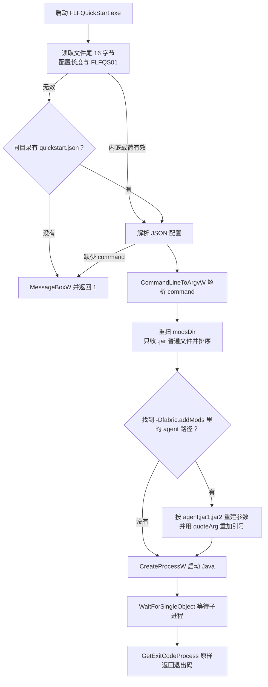

## 八、整合包

`.flfhmclpack` 由 `modpack.cpp` 读写：

- 元数据；
- 实例文件；
- 层配置；
- 导入/导出；
- 路径重写；
- 失败回滚。

导入时不要直接覆盖用户数据；按包策略保留。

## 九、UI

Qt Widgets 主窗口负责实例、账户、下载、设置、日志。长任务放到后台线程，通过信号更新进度；不要阻塞 GUI 线程。

## 十、日志与 CLI

- CommonLoggerCPP 记录日志；
- CrashTrackerHandleLibCPP 捕获崩溃；
- CLI 支持 `launch`、`quickstart`、`validate`、`repair`；
- 退出码用于脚本判断。

## 十一、构建

```powershell
pwsh -NoProfile -File scripts\build.ps1
```

或：

```powershell
cmake -B build -S . -G Ninja `
  -DCMAKE_BUILD_TYPE=Release `
  -DCMAKE_PREFIX_PATH="H:/Qt-static/6.11.1/msvc2022_64" `
  -DCMAKE_TOOLCHAIN_FILE="H:/vcpkg/scripts/buildsystems/vcpkg.cmake" `
  -DVCPKG_TARGET_TRIPLET=x64-windows
cmake --build build --config Release
cmake --build build --target package-release
```

## 十二、测试

- 快速启动器：模组增删、关闭退出；
- 中文路径；
- 覆盖升级；
- 缺 Agent/API；
- HMCL 版本不匹配；
- 导入损坏包；
- CLI 退出码。

## 十三、常见陷阱

- 快速启动器固化模组快照；
- Java 进程因非 daemon 线程残留；
- 覆盖安装未回滚；
- 绝对路径写入可移动包；
- 取消后临时文件未清理；
- 中文路径未使用 UTF-8。

## 十四、架构总览与模块职责

发布版只有一个 `FLFHMCLauncher.exe`，但 CMake 实际产出五个 target：静态核心库、GUI、引导器、CLI 和快速启动器。引导器把自己、payload 与 24 字节尾记录拼成一个文件，运行时把 payload 释放到 `.flfhmcl/bin`，再用环境变量把外层目录交给 GUI。这样发布物是单文件，业务代码仍然分层。

| target | 类型 | 入口 | 主要依赖 | 说明 |
|---|---|---|---|---|
| `FLFLauncherCore` | 静态库 | `src/core/*.cpp` | Qt6::Core、nlohmann_json、CommonLoggerCPP、CrashTrackerHandleLib、winhttp | 全部业务逻辑，GUI 与 CLI 共用 |
| `FLFHMCLauncherApp` | WIN32 GUI | `src/main.cpp` | Core、Qt6::Widgets、Qt6::Concurrent | 真正的主窗口进程 |
| `FLFHMCLauncher` | WIN32 | `src/bootstrap_main.cpp` | shell32 | 用 `/MT` 构建，输出名 `FLFHMCLauncherBootstrap.exe` |
| `FLFLauncherCli` | 控制台 | `src/cli_main.cpp` | Core、Qt6::Core | 无界面安装、修复、自检 |
| `FLFQuickStart` | WIN32 | `src/quickstart_main.cpp` | shell32 | 不链 Qt 的每实例启动器 |

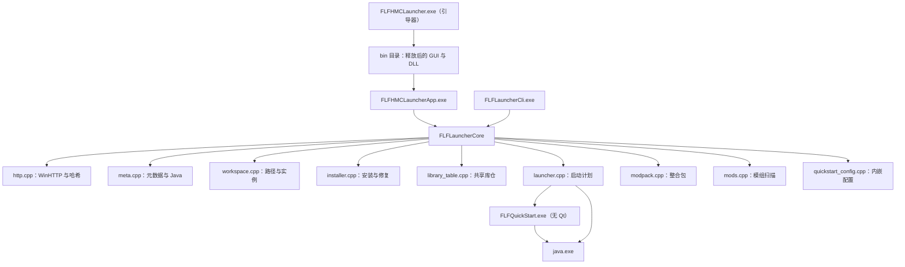

| 文件 | 职责 | 关键符号 |
|---|---|---|
| `core/flf_paths.cpp` | 定位启动器目录、工作区根、日志路径，创建目录骨架 | `executableDirectory`、`flfHome`、`ensureLayout` |
| `core/app_bootstrap.cpp` | 初始化日志与崩溃处理器 | `bootstrap`、`shutdown` |
| `core/workspace.cpp` | 单例工作区：配置、实例列表、路径解析、旧数据迁移 | `Workspace::get`、`resolveMinecraft`、`resolveMods` |
| `core/http.cpp` | WinHTTP GET、断点续传与分片下载、SHA-1/SHA-256 | `httpGet`、`httpDownload`、`sha256File` |
| `core/meta.cpp` | 版本/Fabric/HMCL/FLF 元数据、Java 探测与安装 | `fetchFabricProfile`、`fetchFlfRelease`、`detectJava` |
| `core/library_table.cpp` | 共享库仓索引、按哈希缓存恢复、补齐缺失库 | `LibraryTable::ensure`、`restore` |
| `core/installer.cpp` | 实例安装、修复、CrashTracker 部署 | `installInstance`、`repairInstance`、`ensureCrashTracker` |
| `core/launcher.cpp` | 启动计划、启动协议、进程托管、快速启动器生成 | `buildLaunchPlan`、`launchInstanceManaged`、`writeQuickStart` |
| `core/mods.cpp` | 模组列出、启用/禁用、导入、删除 | `listMods`、`setModEnabled` |
| `core/modpack.cpp` | `.flfhmclpack` 导入导出 | `exportModpack`、`importModpack` |
| `core/quickstart_config.cpp` | 内嵌配置的写入、截断与读取 | `appendQuickStartConfig`、`loadQuickStartConfig` |
| `ui/mainwindow.cpp` | Qt Widgets 界面、线程调度、启动输出展示 | `MainWindow` |

Core 层除了 Qt6::Core 的 `QCryptographicHash`、`QProcess`、`QStandardPaths`、`QTemporaryDir` 之外不碰界面。所有写入 JSON 或 JVM 参数的路径都必须经过 `path_util.h` 的 `pathUtf8`，因为 Windows 上 `path::string()` 返回当前 ANSI 代码页，中文路径会变成非法 UTF-8。

## 十五、bootstrap：载荷布局、释放与自更新

发布 EXE 的尾部结构（全部小端）：

```text
[ 引导器 PE ][ payload ][ footer 24 字节 ]
footer : magic "FLFEND01"(8) + uint64 offset + uint64 size
payload: magic "FLFPAY01"(8) + uint32 version(=1) + uint32 count(不超过 64)
entry  : uint32 nameLen + name(UTF-8，不超过 260 字节) + uint64 size + 文件数据
```

读取顺序是：用 `GetModuleFileNameW` 取自身路径，跳到文件尾 24 字节读 footer，校验 magic、`size` 非零、`offset + size` 不超过 `fileSize - 24`，再读 payload、校验 `FLFPAY01` 与版本号，最后逐条解析。条目名里出现 `/`、`\`、`:`、`.`、`..` 直接判为损坏，避免载荷把文件写到 `bin` 之外。

释放分三步：建 `.flfhmcl/bin`；每个条目先写 `<目标>.tmp`，再用 `MoveFileExW(MOVEFILE_REPLACE_EXISTING | MOVEFILE_WRITE_THROUGH)` 原子替换；最后写 `.payload` 标记，内容是 `<offset>-<size>`。下次启动时 `payloadCurrent` 同时检查标记和每个条目是否存在，一致就整段跳过释放。

拉起 GUI 时设置 `FLFHMCL_LAUNCHER_DIR`，用 `CreateProcessW` 以启动器目录为工作目录启动 `FLFHMCLauncherApp.exe`，把 exe 之后的命令行原样转发（`commandLineAfterExe` 负责跳过带引号的程序名），拿到句柄后立即关闭、不等待 GUI。

容错有三条：正在运行时 GUI 占着 `bin` 里的文件，`MoveFileExW` 会失败，只要 `FLFHMCLauncherApp.exe` 已存在就继续启动现有版本；没有 payload 的开发目录回退到引导器同目录找 app；只有连 app 都找不到才弹 `MessageBoxW` 并返回 1。

自更新方面，bootstrap 不下载任何东西，它只保证"EXE 换了就重放"。用新构建覆盖发布 EXE 后 footer 里的 `offset/size` 变化，`.payload` 标记不再匹配，下次运行自动重新释放到 `bin`。覆盖动作必须在 GUI 完全退出后做，否则正在被映射的 EXE 与 DLL 无法替换；`.flfhmcl` 目录不在 payload 内，实例、库和日志不随 EXE 替换丢失。

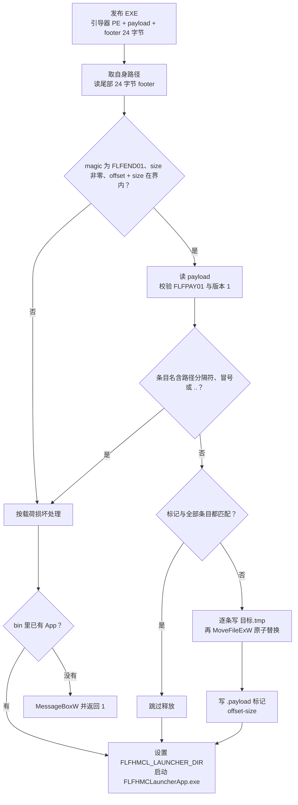

## 十六、工作区路径解析

`Workspace` 是进程内单例。`initialize()` 先调 `ensureLayout()` 建骨架（`bin`、`config`、`libraries`、`java`、`javafx`、`fabric`、`hmcl`、`tools/CrashTracker`、`instances`、`cache/downloads`、`cache/meta`、`logs`、`crash-report`），再读 `config/launcher.json` 与 `config/instances.json`。

| 用途 | 位置 | 解析入口 |
|---|---|---|
| 启动器目录 | `FLFHMCL_LAUNCHER_DIR` 环境变量，缺省为模块所在目录 | `executableDirectory` |
| 工作区根 | `<启动器目录>/.flfhmcl` | `flfHome` |
| 全局配置 | `.flfhmcl/config/launcher.json` | `saveConfig` |
| 实例列表 | `.flfhmcl/config/instances.json` | `saveInstances` |
| 实例目录 | `.flfhmcl/instances/<uuid>`，uuid 为空时退回 id | `instanceDir` |
| 实例配置目录 | `.flfhmcl/profile/<uuid>` | `profileDir` |
| mclhr 清单 | `.flfhmcl/profile/<uuid>/mclhr.json` | `manifestPath` |
| 模组目录 | shared 模式 `.flfhmcl/mods/general`，否则 `.flfhmcl/mods/<uuid>` | `resolveMods` |
| 游戏目录 | 隔离实例 `../.launcher/<uuid>/.minecraft`，否则 `../.minecraft` | `resolveMinecraft` |
| HMCL 配置 | 隔离实例 `../.launcher/<uuid>/.hmcl`，否则 `../.hmcl` | `resolveHmclHome` |
| 共享库 | `.flfhmcl/libraries/<group_artifact_version[-classifier]>.jar` | `librariesDir` |
| HMCL jar | `.flfhmcl/hmcl/HMCL-<版本>.jar`，无版本时 `.flfhmcl/hmcl/HMCL.jar` | `hmclJar` |
| Agent | `.flfhmcl/agents/FLFHMCL-<版本>.jar`；无版本时按配置绝对路径、启动器目录、`.flfhmcl/hmcl` 依次回退 | `agentJar` |
| Java | `.flfhmcl/java`，自动安装的是 `temurin-21` | `javaDir` |
| Fabric profile | `.flfhmcl/fabric/<游戏版本>/<loader 版本>/profile.json` | `fabricDir` |
| 共享目录 | `.flfhmcl/shared/<种类>/<分组>` | `sharedDir` |
| 日志 | `.flfhmcl/logs/launcher.log`、`instance-<uuid>.log` | `logFile` |
| 崩溃报告 | `.flfhmcl/crash-report` | `ensureLayout` |

`Layer` 由 `mode` 与 `group` 组成，`mode` 取 `private`、`shared`、`group`，`group` 默认 `default`；读入时非法的 mode 回落成 `private`，分组名会过 `sanitizeId` 只保留字母、数字与连字符。实例的 `isolated` 为真时整个 `.minecraft` 与 `.hmcl` 搬到 `.launcher/<uuid>/` 下，和全局目录彻底分开。

`instances.json` 每个条目写 `uuid`、`id`、`name`、`gameVersion`、`loader`、`loaderVersion`、`javaPath`、`agentVersion`、`hmclVersion`、`hmclSha1`、`flfApiVersion`、三层 `Layer`、`isolated`、`launchBehavior`、`createdAt`。读入时做三件兼容：旧的 id 目录重命名到 uuid 目录；旧的 `instances/<uuid>/mclhr.json` 复制到 `profile/<uuid>/`；`flfApiVersion` 按四段命名迁移（例如 `1.2.0-hmcl3.16` 变 `1.2.2.16`）。JSON 损坏时清空列表继续启动，不阻断界面。

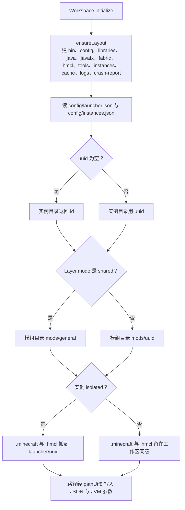

## 十七、安装器：下载、镜像、校验、原子替换与回滚

`installInstance` 是一条固定顺序的流水线，进度条百分比直接对应阶段：

| 阶段 | 动作 | 进度 |
|---|---|---|
| 准备目录 | 建 `profile/<uuid>`、模组目录、游戏目录 | 5 |
| Java | 已有路径可用就复用，否则探测本机，再不行下载 Temurin 21 并解压 | 5 |
| JavaFX | 按 JVM 主版本选 17.0.13、21.0.13、22.0.2、23.0.2、24.0.1，拉 base/graphics/controls 的 win 包 | 10-25 |
| Fabric | 取 profile JSON 落盘，再逐个补齐库 | 30-60 |
| HMCL 依赖 | Gson、Guava、jsr305、checker-qual、error_prone 等 | 62-66 |
| HMCL | 取版本与 SHA-1，下载到 `hmcl/HMCL-<版本>.jar` | 75-88 |
| Agent | 元数据取版本与 SHA-256，下到临时文件再改名 | 88-93 |
| FLF API | 按 HMCL 与 Agent 版本挑适配版本，放进实例模组目录 | 93-95 |
| FLF Title | 可选装饰模组，元数据不可用时跳过 | 96-97 |
| 清单与校验 | 写 `mclhr.json`，再按清单校验一遍 | 98-100 |

数据源都写死在代码里，换镜像就是改传入的基址：

| 对象 | 数据源 |
|---|---|
| 原版版本列表 | `https://piston-meta.mojang.com/mc/game/version_manifest.json` |
| Fabric Loader 列表 | `https://meta.fabricmc.net/v2/versions/loader/<游戏版本>` |
| Fabric profile | 上一地址追加 `/<loader 版本>/profile/json` |
| Fabric 库 | profile 里的 `url`，缺省 `https://maven.fabricmc.net/` |
| HMCL 最新版 | `https://hmcl.huangyuhui.net/api/update_link?version=0.0&channel=stable`，返回版本、jar、jarsha1 |
| HMCL 版本史 | GitHub Releases 前 40 条，配合 `api/download_link` 的 stable/dev/old |
| HMCL 指定版本 | `https://hmcl.glavo.site/download/HMCL-<版本>.jar`，这个源不给 SHA-1 |
| FLF 元数据 | `https://metadata.hibernet.top/api/metadata`，`type` 取 `flfhmcl`、`flfapi` 或 `flftitle` |
| Maven 依赖 | `https://repo1.maven.org/maven2/` |
| Java 运行时 | Adoptium 的 latest 21 windows x64 jdk 二进制 |

`launcher.json` 里保留了 `mirrors` 字段，但当前下载器只接受一个 URL，镜像要靠上层改写基址或 URL 生效，不是运行时自动回退。

| 环节 | 校验 | 失败处理 |
|---|---|---|
| HMCL jar | 元数据 `jarsha1` 的 SHA-1 | 报错终止；`repair` 会删掉旧文件重下 |
| Agent jar | 元数据 `sha_256` | 删除临时文件，保留旧版本 |
| FLF API 与 Title | 元数据 `sha_256` | 删除刚下载的文件 |
| 共享库 | 记录 `sha256` 与大小，缺失时先试 `.flfhmcl/cache/<sha256>` | 无缓存再按 `source` 下载 |
| CrashTracker | 固定 SHA-256 | 内置与 Release 都不可用时只记警告 |

下载统一走 `httpDownload`。它先用 `Range: bytes=0-0` 探测是否支持分片：支持、总大小不小于 4 MiB 且没有可续传的 `.part` 时开 4 个线程各拿一段（状态码必须是 206），否则单流写 `<目标>.part`，中断后重跑会带 `Range: bytes=<已有大小>-` 续传。所有路径最后都归到 `fs::rename(part, dest)`；目标已存在导致 rename 失败时，先删目标再 rename 一次，正式路径上不会出现半个文件。进度回调返回 false 即取消：单流删 `.part`，分片删所有分片。

安装流水线本身没有事务，失败时已完成的阶段保留（Java、已校验的库、HMCL jar），重跑会复用，所以"回到干净状态"要删实例目录再装。真正有回滚的是整合包导入：`cleanupImported` 会删实例目录、profile、模组目录和隔离目录，失败不会留下半成品实例。

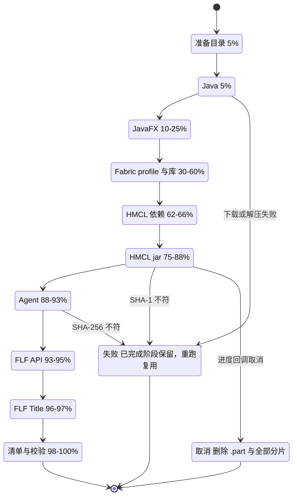

## 十八、启动计划：参数顺序与代码流程

`buildLaunchPlan(instance, quickStart)` 产出 `LaunchPlan{program, arguments, workingDir, provider}`。`program` 取实例的 `javaPath`，为空就用 `detectJava()` 的第一个；`workingDir` 是游戏目录的父目录；生成前先建好游戏目录与 HMCL 配置目录，并跑一次 `repairHmclAcl`。

启动协议由 `LaunchProvider` 决定，列表里 Knot 在前、legacy 在后，`supports` 取第一个命中，legacy 永远命中所以兜底。Knot 的门槛是 `agentVersion >= 2.1.6`（源码注释写的 2.1.5 已过时，以判定语句为准）。

公共参数按下面的顺序排，前 12 个对所有协议一致：

| 序号 | 参数 | 取值 |
|---|---|---|
| 1 | `-javaagent:<路径>` | `agentJar(instance)` |
| 2 | `-Dflf.libraries.dir=` | `.flfhmcl/libraries` |
| 3 | `-Dflfhmcl.gameDir=` | 游戏目录 |
| 4 | `-Dflf.instance=` | 实例 id |
| 5 | `-Dflf.loader.version=` | Fabric Loader 版本 |
| 6 | `-Dflf.mclhr.manifest=` | `profile/<uuid>/mclhr.json` |
| 7 | `-Dflf.profile=` | `profile/<uuid>` |
| 8 | `-Dflf.version=` | Agent 版本 |
| 9 | `-Dflf.home=` | `.flfhmcl` 根 |
| 10 | `-Dflfhmcl.update.managed=true` | 常量，关闭 HMCL 自更新 |
| 11 | `-Dhmcl.home=` | HMCL 配置目录 |
| 12 | `-Dhmcl.dir=` | 同上，HMCL 两个键都会读 |

协议尾部：

| 协议 | 参数 | 说明 |
|---|---|---|
| knot | `-Dflf.knot.direct=true` | 声明由 Knot 直接拉起 |
| knot | `-Dfabric.addMods=` | agent jar 加上模组目录里按文件名排序的全部 jar，分号分隔 |
| knot | `-Dflf.hmcl.jar=` | HMCL jar 交给 agent 加载 |
| knot | `-cp` 与 agent jar | classpath 只放 agent |
| knot | `net.fabricmc.loader.impl.launch.knot.KnotClient` | 主类 |
| knot | `--gameDir` 与游戏目录 | 游戏目录 |
| knot | `--hmclMainClass org.jackhuang.hmcl.Launcher` | HMCL 主类 |
| legacy | `-jar` 与 HMCL jar | 旧版由 Agent 拦截入口 |
| 两者 | `--flf-instance=<id>` | 只在生成快速启动器时追加 |

代码流程：

1. 主窗口取选中实例，必要时补写 `profile/<uuid>/instance.json` 与 `launch.json`；
2. 实例和全局都开了启动前校验就 `validateInstanceFiles`，失败直接转 `beginRepair`；
3. 开了启动前检查就在后台比对组件更新，只弹提示，不阻塞启动；
4. `launchInstanceManaged` 建 `CreatePipe`，把 stdout 与 stderr 合到同一个管道，用 `CREATE_NEW_PROCESS_GROUP | CREATE_NO_WINDOW` 启动 Java；
5. 一个线程按 4096 字节块 `ReadFile` 回吐输出，另一个线程 `WaitForSingleObject(INFINITE)` 等退出并回调退出码；
6. 主窗口把输出追加到 `logs/instance-<uuid>.log`，看到 `Loading Done!` 提示启动完成，非零退出码或典型异常串则提示崩溃并附最近一份崩溃报告。

顺序不能随意改：JVM 先解析 `-javaagent` 与 `-D` 选项再决定主类，`-cp` 或 `-jar` 之后的内容一律当游戏参数；Knot 模式下 HMCL 由 Fabric 加载，`-Dfabric.addMods` 必须同时包含 agent jar 与实例模组，否则只有 agent 生效；`--flf-instance` 只在快速启动器里出现，GUI 启动保持 HMCL 正常界面。另有两条轻量入口：`launchInstance` 用 `QProcess::startDetached` 点火即走，`writeQuickStart` 只生成快速启动器、不启动进程。

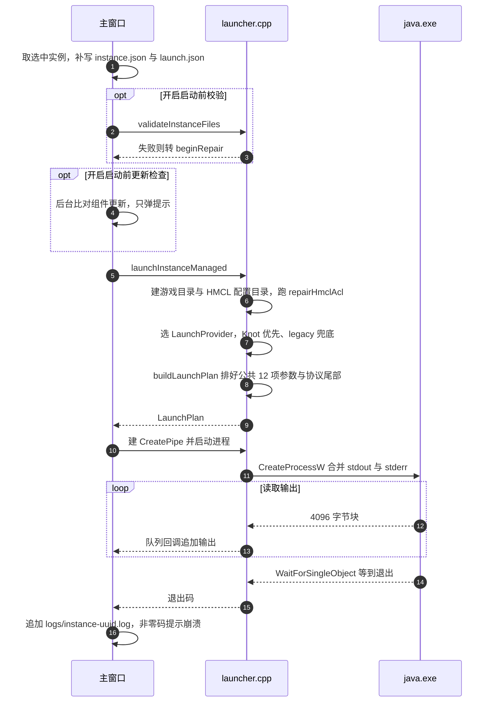

## 十九、快速启动器：载荷、重扫、引号与进程

快速启动器是独立 EXE，配置直接追加在文件尾：

```text
[ 原始 FLFQuickStart.exe ][ JSON 配置 ][ uint64 小端长度 ][ "FLFQS01\n" ]
```

尾记录固定 16 字节：前 8 字节是配置长度，后 8 字节是 magic。读取时先找内嵌载荷，失败再看同目录的 `quickstart.json`（手工调试用）。配置上限 64 MiB，长度超出或越过文件头一律判无效。

| 字段 | 含义 |
|---|---|
| `root` | 启动器根目录，相对路径按 EXE 所在目录解析 |
| `instance` | 实例 id |
| `modsDir` | 模组目录；缺省用 `root/.flfhmcl/mods/<instance>` |
| `command` | 生成时的完整命令行，含 Java 路径与全部 JVM 参数 |
| `workingDir` | 子进程工作目录 |
| `checkUpdates` 与 `updateComponents` | 更新检查偏好，当前只记录不执行 |
| `baseRoot` | 可选，目录整体搬迁后用于把旧根前缀替换成新根前缀 |

生成时 `writeQuickStart` 先把 `FLFQuickStart.exe` 复制成目标文件（可改名），再用 `buildLaunchPlan(instance, true)` 拿到带 `--flf-instance` 的计划，`joinCommand` 拼成命令行，最后 `appendQuickStartConfig` 追加。追加前如果尾部已有合法载荷，会先 `resize_file` 截断到原 EXE 长度，反复生成不会让载荷叠加。

运行时重扫 `modsDir` 的算法：

1. 用 `CommandLineToArgvW` 把 `command` 解析成 argv；
2. 找第一个以 `-Dfabric.addMods=` 开头的参数，取等号后、第一个分号前的那段当 agent 路径；
3. agent 为空就放弃改写，直接用原命令行；
4. 用 `directory_iterator` 扫模组目录（不递归），只收普通文件和 `.jar` 后缀，按路径排序；
5. 用 `agent;jar1;jar2` 重建参数，再逐项 `quoteArg` 拼回一条命令行。

引号规则是 MSVCRT 的那一套：空串写成两个双引号；含空格、制表符或双引号才加引号；引号前的反斜杠翻倍，末尾反斜杠也要翻倍再加收尾引号。这样重建出来的命令行再被 `CommandLineToArgvW` 解析时能还原成同样的 argv。

启动与等待分四步：`CreateProcessW(nullptr, 命令行缓冲, ..., CREATE_NO_WINDOW, workingDir)`；关掉 `hThread`；`WaitForSingleObject(hProcess, INFINITE)`；`GetExitCodeProcess` 后把子进程退出码原样返回。配置里没有 `command` 或 `CreateProcessW` 失败时弹 `MessageBoxW` 并返回 1。

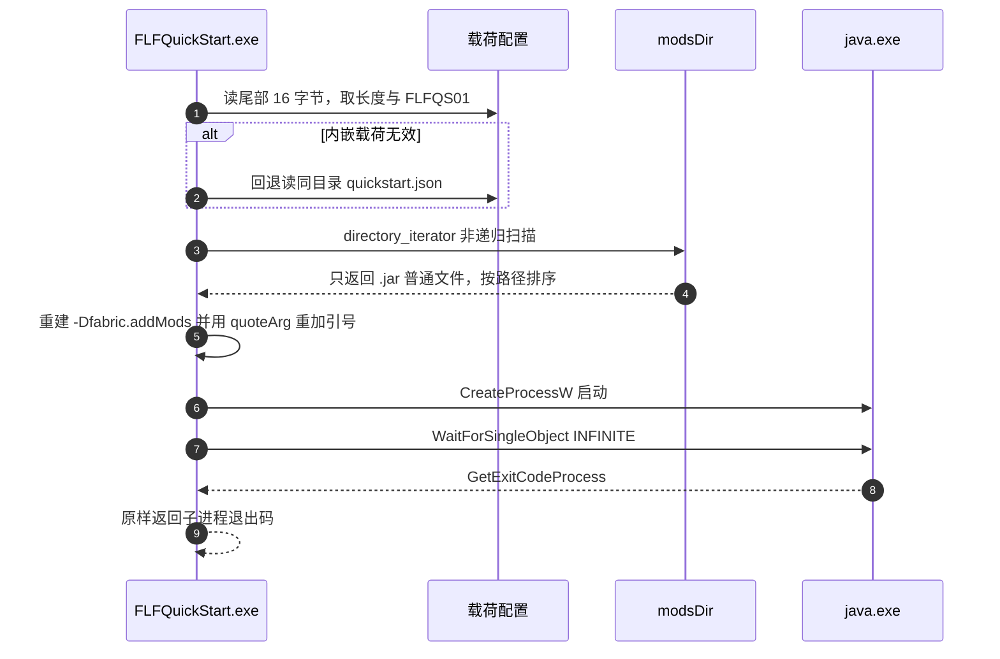

## 二十、整合包格式：`.flfhmclpack` 的读写

`.flfhmclpack` 是带清单的 zip，不是把实例目录直接压缩：

```text
pack.zip
├─ flfhmclpack.json
└─ payload/
   ├─ minecraft/   游戏目录里选中的文件
   ├─ hmcl/        过滤后的 HMCL 配置
   ├─ mods/        实例模组
   ├─ profile/     profile 目录内容
   └─ runtime/     hmcl/HMCL-<版本>.jar 与 agents/FLFHMCL-<版本>.jar
```

清单字段：

| 字段 | 内容 |
|---|---|
| `format` 与 `schema` | 固定 `flfhmclpack` 与 `1`，导入时严格比对 |
| `generator` | 生成器名与版本（版本目前是写死的常量） |
| `name` 与 `instance` | 实例名与完整实例元数据 |
| `workspace` | 全局配置快照 |
| `hmclSelection` | 是否带 config/state/cache/logs，是否清洗令牌 |
| `mods` | 每个模组的路径、大小、SHA-256、是否内嵌、下载地址 |
| `directories` | 空目录列表，导入时按 role 重建 |
| `files` | 每个文件的 path、role、size、sha256，runtime 另有 target |

导出流程：建临时目录，按 role 收集文件并计算 SHA-256；HMCL 目录先按选择过滤（`logs`、`cache`、`config`、`state` 四类可关），开启清洗时把 JSON 里键名含 token、password、secret、credential、session 的字段删掉；符号链接一律跳过，不跟随到实例目录之外；写 `flfhmclpack.json`；用系统 `tar.exe -a -c -f` 打 zip；最后复制到目标路径。不嵌入的模组只写下载地址，包体积能小很多。

导入流程：把包复制进临时目录并解压；校验 format 与 schema；读 `instance` 生成新 uuid 与不冲突的 id（冲突时追加 `-2`、`-3`）；强制 `isolated` 为真、三层全部私有，避免覆盖全局目录；先按 `directories` 建空目录，再按 `files` 校验 SHA-256 后落盘；runtime 文件直接写到 `.flfhmcl` 下的 `hmcl/` 与 `agents/`；链接型模组按 `url` 下载并校验；把原始清单复制成 `instances/<uuid>/modpack.json` 留档；最后注册实例并写配置。任何一步失败都走 `cleanupImported` 回滚。

安全边界靠 `safeRelative`：绝对路径、含 `..` 或 `.` 的段一律拒绝；`payload/<role>/<相对路径>` 的拼法保证了写入点始终落在对应 role 的根目录下。

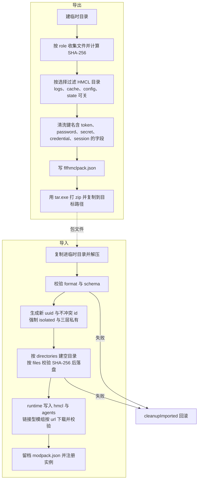

## 二十一、Qt UI 的线程模型

界面只用 Qt Widgets，长任务全部出主线程，只有两种通道：

- `std::thread` 加 `QMetaObject::invokeMethod(this, ..., Qt::QueuedConnection)`，用于安装、修复、启动输出、加载版本列表；
- `QtConcurrent::run` 加 `QFutureWatcher`，用于整合包导入导出这种一次性任务。

避免陈旧结果靠令牌：`agentToken_`、`hmclToken_`、`fabricToken_`、`apiToken_`、`updateLoadToken_` 在每次重新加载或停止时自增，工作线程拿着旧令牌回到主线程后先比对，不相等就直接丢弃。对话框用 `QPointer` 守护，关闭后回调不再触碰已销毁的控件。

几条硬规则：worker 里不能碰任何 QWidget，也不能读 `Workspace` 的可变容器，要先把 `Instance` 拷成快照再传进去；跨线程只传 `QString`、`QStringList` 和值类型；`launchInstanceManaged` 的输出回调同样要再 invoke 回主线程，才能写 `runLog_` 和日志文件；`QTimer::singleShot(0)` 用于延迟处理拖到 exe 上的整合包，`singleShot(1500)` 用于首次运行部署 CrashTracker。

启动行为分 `keep`、`hide`、`exit` 三档，实例设置优先、为空时继承全局。三档都在 `launchInstanceManaged` 返回成功之后才执行，避免启动失败把窗口藏没了。

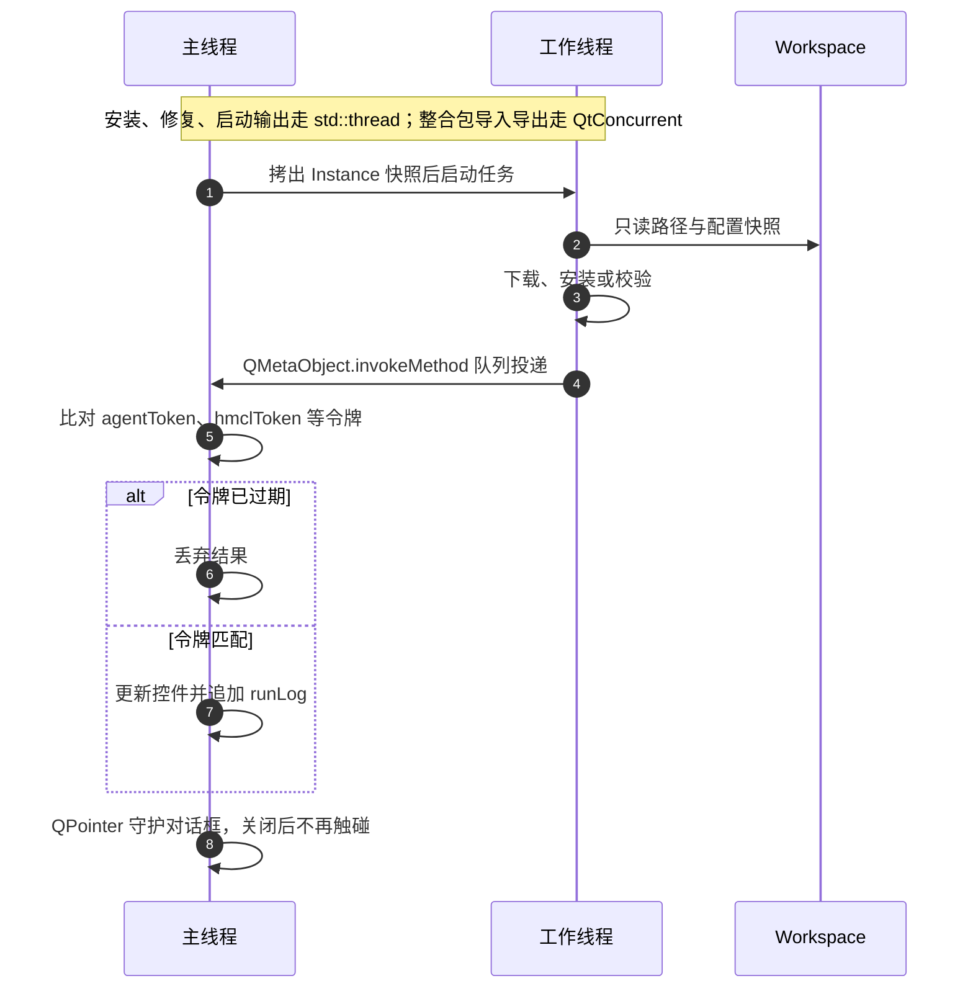

## 二十二、日志、CrashTracker 与 CLI 退出码

`bootstrap()` 先建目录骨架，再 `CLogger::Init(.flfhmcl/logs/launcher.log, "flfhmlauncher")`，写一条带工作区根的启动 Info；`shutdown()` 在事件循环结束后写退出 Info。实例运行输出另外落到 `.flfhmcl/logs/instance-<uuid>.log`，崩溃现场在 `.flfhmcl/crash-report/`。

崩溃处理由 `HiBerCTM` 接管：`InstallCrashHandler(根目录)`、`SetCrashAppName("FLFHMCLauncher")`、`SetCrashHelpText(...)`、`InstallCrtReportHook()`。分析工具 `CrashTracker.exe` 在首次运行约 1.5 秒后部署：先解内置资源并校验固定 SHA-256，失败再拉 GitHub 最新 Release 的 `CrashTracker_Static.exe`，落到 `.flfhmcl/tools/CrashTracker/`，再硬链接到 `.flfhmcl/bin/`（文件系统不支持硬链接时退回复制），并清理启动器根目录里的旧副本。

CLI 的入口是 `FLFLauncherCli`，先 `Workspace::get().initialize()` 再分发：

| 命令 | 参数 | 行为 |
|---|---|---|
| `selftest` | 无 | 打印版本数、Fabric loader 数与 HMCL 状态 |
| `install` | 实例 id、游戏版本、loader 版本、Java 路径 | 走完整安装流水线并保存实例 |
| `launch` | 实例 id | 托管启动并等待退出 |
| `repair` | 实例 id | 修复 Java、Agent、HMCL、库与清单 |
| `validate` | 实例 id | 只校验文件与清单 |
| `quickstart` | 实例 id、输出 exe | 生成快速启动器 |
| `export-pack` | 实例 id、输出包 | 导出整合包 |
| `import-pack` | 包路径 | 导入整合包 |

退出码是脚本判断的依据：

| 退出码 | 含义 |
|---|---|
| 0 | 成功 |
| 1 | 用法错误：未知子命令或参数不足，打印 usage |
| 2 | 找不到实例，或没有可用的 Fabric loader |
| 3 | 操作失败：安装、修复、校验、导入导出、写快速启动器或启动 Java 失败 |
| 4 | `launch` 启动成功但 Java 子进程以非零码退出 |

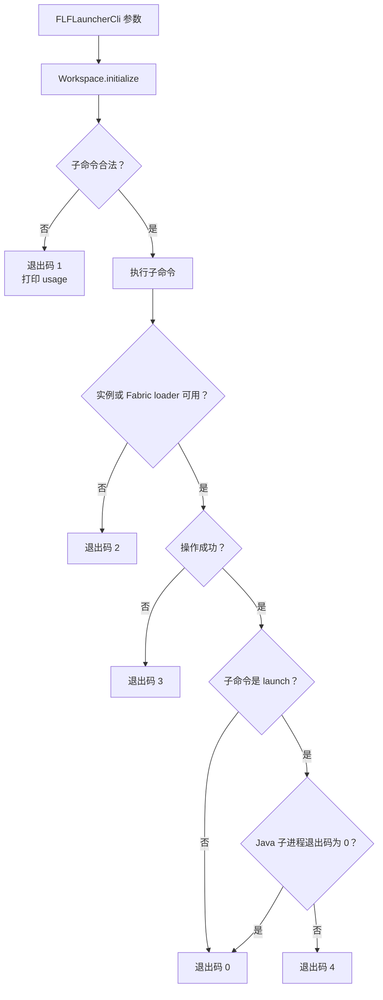

## 二十三、CMake、构建与发布

工具链：CMake 3.25 及以上、C++20、MSVC 2022、静态 Qt 6.11.1、vcpkg 的 `x64-windows`、Ninja。MSVC 下统一加 `/utf-8 /permissive-`，否则中文注释与字符串会按 GBK 解析坏。

| 选项 | 默认 | 作用 |
|---|---|---|
| `FLF_ENABLE_HIBERGUI` | ON | 链 HiBerGUILibrary，需要 nlohmann-json |
| `FLF_ENABLE_WEBVIEW2` | OFF | 构建 WebView2 组件，需要 vcpkg 的 webview2 |
| `FLF_BUILD_QUICKSTART` | ON | 构建无 Qt 的快速启动器 |
| `FLF_BUILD_EXAMPLES` | OFF | 构建示例 |

一条命令构建并打包：

```powershell
pwsh -NoProfile -File scripts\build.ps1
```

脚本参数是 `-QtRoot`、`-VcpkgRoot`、`-BuildDir`、`-Triplet`、`-VcVars`，内部先 `vcvars64.bat` 再 configure、build，最后跑 `package-release`。手动等价流程：

```powershell
call "F:\Program Files\Microsoft Visual Studio\18\Community\VC\Auxiliary\Build\vcvars64.bat"
cmake -B build -S . -G Ninja -DCMAKE_BUILD_TYPE=Release `
  -DCMAKE_PREFIX_PATH="H:/Qt-static/6.11.1/msvc2022_64" `
  -DCMAKE_TOOLCHAIN_FILE="H:/vcpkg/scripts/buildsystems/vcpkg.cmake" `
  -DVCPKG_TARGET_TRIPLET=x64-windows
cmake --build build --config Release
cmake --build build --target package-release
```

`package-release` 是自定义 target，依赖引导器、GUI 与快速启动器三个产物，实际执行 `scripts/package-release.ps1 -BuildDir`：检查 `FLFHMCLauncherBootstrap.exe`、`FLFHMCLauncherApp.exe`、`FLFQuickStart.exe`、`spdlog.dll` 与图标；用 `vswhere` 找到最高版本的 VC Redist，挑出 `msvcp140*` 与 `vcruntime140*`；按 footer 布局拼出单文件 EXE。子模块要先拉齐：`git submodule update --init --recursive`（HiBerGUILibCPP、CommonLoggerCPP、CrashTrackerHandleLibCPP）。安装规则只装发布 EXE 和 `flfhmclpack.ico`，其余目录由首次运行创建。

构建完的最小验证：直接运行 `build\FLFHMCLauncher.exe`，确认 `.flfhmcl/bin` 被释放且 GUI 出现；再跑 `build\FLFLauncherCli.exe selftest`，确认元数据源可达。

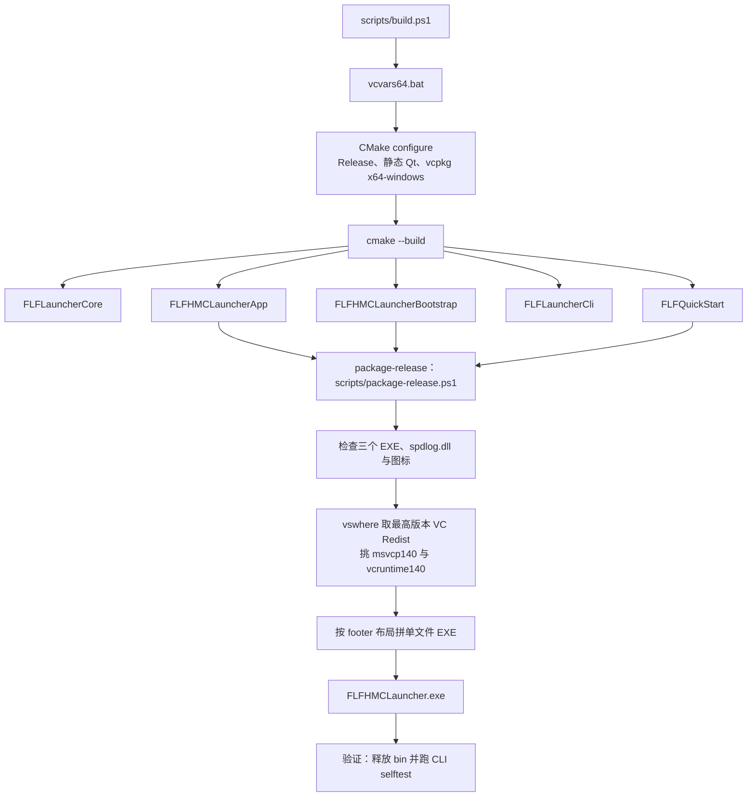

## 二十四、测试矩阵

| 编号 | 场景 | 步骤 | 通过标准 |
|---|---|---|---|
| 1 | 首次释放 | 删掉 `.flfhmcl/bin` 后运行发布 EXE | 目录内文件齐全，`.payload` 标记生成，GUI 启动 |
| 2 | 载荷更新 | 用新构建覆盖 EXE 后再次运行 | 重新释放，GUI 版本号随之变化 |
| 3 | 载荷损坏 | 截断 EXE 尾部或改坏 footer magic | 不静默启动；有既有 app 时回退启动，否则弹错误框 |
| 4 | 中文与空格路径 | 把整个目录放到中文加空格路径下运行 | 释放、启动、日志路径都正确，无乱码 |
| 5 | CLI 自检 | `FLFLauncherCli selftest` | 打印版本与 Fabric 数量，退出码 0 |
| 6 | CLI 退出码 | 对不存在的实例执行 `launch` 与 `validate` | stderr 说明原因，退出码 2 |
| 7 | 安装与修复 | 空工作区跑 `install`，再删几个库跑 `repair` | 进度到 100，`validate` 通过，缺失库被补回 |
| 8 | 模组重扫 | 生成快速启动器后增删 jar 再运行 | 实际命令行里的 `-Dfabric.addMods` 反映最新列表 |
| 9 | 快速启动器退出 | 打开生成的 EXE，正常关闭 HMCL | Java 与启动器进程都退出，退出码透传 |
| 10 | 整合包往返 | 导出后换目录导入 | 新 uuid、强制隔离、SHA-256 全部通过，失败时回滚干净 |
| 11 | 覆盖升级 | 在旧版本目录上直接覆盖新 EXE | 实例与配置保留，`.flfhmcl` 未被清空 |
| 12 | 崩溃上报 | 制造一次 Java 崩溃 | `crash-report` 有报告，`launcher.log` 有记录，界面提示崩溃 |

## 二十五、常见陷阱

| 编号 | 现象 | 根因 | 对策 |
|---|---|---|---|
| 1 | 加进模组目录的 jar 不生效 | 生成时把 `-Dfabric.addMods` 快照写死进命令行 | 每次启动都重扫模组目录重建该参数 |
| 2 | 关掉 HMCL 后 Java 还在跑 | 子进程里有非 daemon 线程没停 | 由启动器托管进程并等待退出，异常时按 PID 清理 |
| 3 | 覆盖升级后实例打不开 | 新 EXE 与旧 `bin` 混用，组件版本错位 | 靠 `.payload` 标记触发重新释放，升级前备份 `.flfhmcl` |
| 4 | 包搬到别的机器就不能用 | 载荷里写的是生成时的绝对 `root` 与 `command` | 写入端尽量用相对 root，或补 `baseRoot` 让解析时替换前缀 |
| 5 | 取消下载后磁盘越用越多 | `.part` 与分片残留没清 | 取消路径删 `.part` 与全部分片 |
| 6 | 中文路径下 JVM 参数乱码 | 用 `path::string()` 取到的是 ANSI | 一律走 `pathUtf8` 与 `pathFromUtf8` |
| 7 | 模组分组设了却没分目录 | `resolveMods` 只区分 shared 与私有，`group` 未参与 | 需要分组时把 `mode` 落成 shared 并约定共享目录 |
| 8 | GUI 正在运行时覆盖 EXE 失败 | `MoveFileExW` 撞上被映射的 PE 与 DLL | 先退出 GUI，再覆盖；bootstrap 容忍提取失败并启动旧 app |
| 9 | 快速启动器体积越来越大 | 反复生成不断追加载荷 | 追加前按尾部长度截断旧载荷 |
| 10 | HMCL 初始化卡住或跳过 | 继承的 Everyone 拒绝 ACL 让可写性判断失败 | 启动前用 `icacls` 去拒绝项并给当前用户完全控制 |
| 11 | 界面随机崩溃或串数据 | 工作线程直接读写控件或可变容器 | 只回主线程改 UI，传值类型与快照，用令牌丢弃过期结果 |
| 12 | 启动时 classpath 冲突 | mclhr 清单混入多个 fabric-loader 或版本不匹配的 JavaFX | 写清单时按实例版本过滤并去重，校验阶段直接拒绝重复库 |

> 外部业务组件不在本文范围；启动器只负责通用平台能力。
