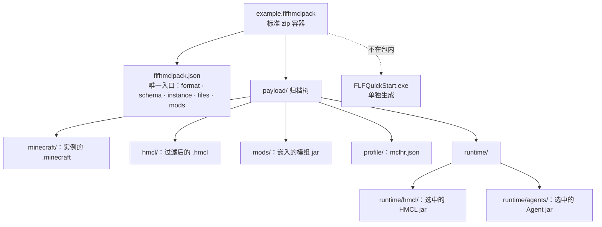
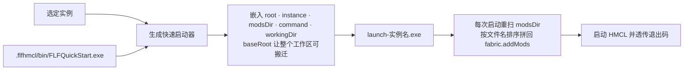
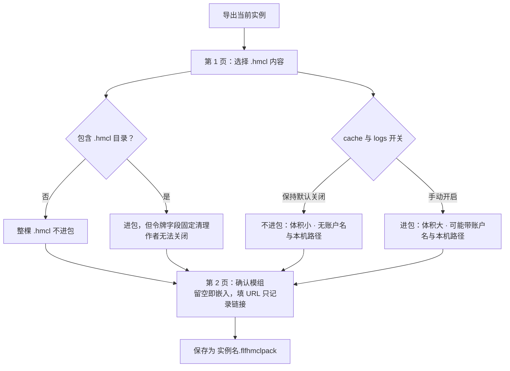
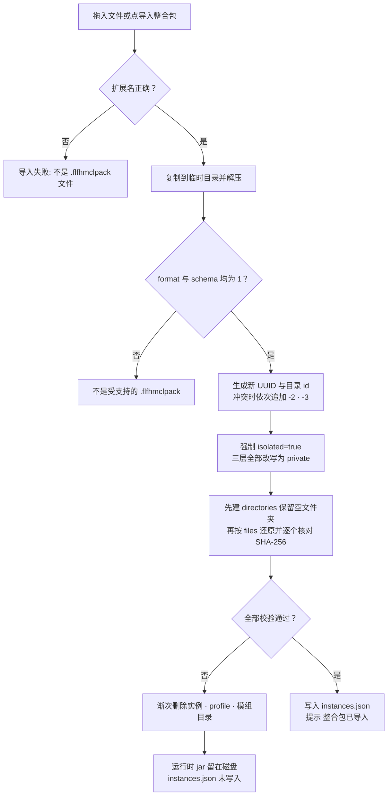
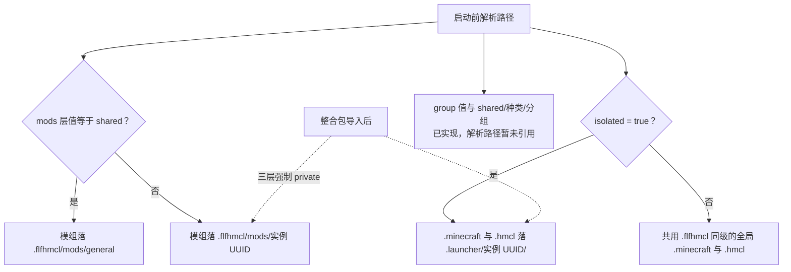
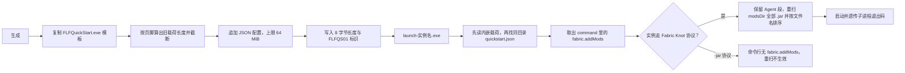
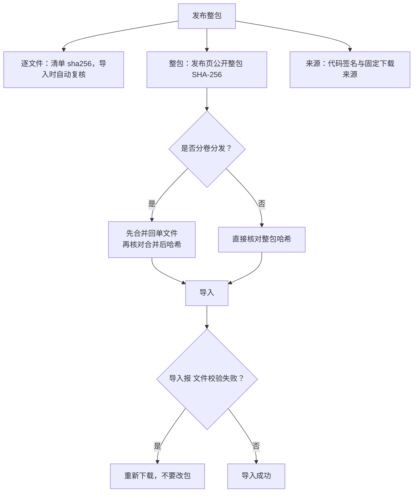

FLFHMCLauncher 的整合包格式是 `.flfhmclpack`。它不是普通 zip：除了实例文件，还记录版本、层隔离、组件与启动信息。本文说明怎样导出、分发、导入和测试。



## 一、包内包含什么

一个可用的整合包通常包含：

- 实例元数据（HMCL、Fabric、Java、Agent、FLF API 版本）；
- `.minecraft` 的游戏版本、配置、模组；
- `.hmcl` 的启动器配置；
- 层隔离配置；
- 可选的快速启动器。

不包含：用户账户令牌、个人存档（除非明确选择）、日志、缓存。

## 二、导出

1. 在实例列表选择实例；
2. 选择“导出整合包”；
3. 选择包含的内容；
4. 选择是否包含用户数据；
5. 生成 `.flfhmclpack`；
6. 校验文件大小与 SHA-256。

导出前清理：

- 测试模组；
- 旧日志；
- 临时文件；
- 与包无关的账户信息。

## 三、导入与覆盖

导入时启动器会：

- 检查包格式与版本；
- 创建/选择实例；
- 按层策略写入文件；
- 保留用户模组（如果包配置允许）；
- 失败时回滚。

覆盖安装前必须备份。不要假设“导入一定覆盖全部文件”；以包元数据为准。

## 四、实例布局

```text
<实例>/
├─ .minecraft/       游戏与模组
├─ .hmcl/            HMCL 配置
├─ profile/          启动配置
├─ logs/             日志
└─ crash-report/     崩溃报告
```

层隔离会把这些目录映射到私有、共享或分组位置。

## 五、层隔离

| 模式 | 适用 | 注意 |
|---|---|---|
| 私有 | 单实例独立 | 体积大，升级简单 |
| 共享 | 多实例共用游戏/模组 | 模组冲突需处理 |
| 分组 | 同组共享 | 组配置要一致 |

推荐：整合包默认私有；需要多版本共用资源时再用共享/分组。

## 六、平台与 API 打包

- 打包 FLFHMCL Agent 的匹配版本；
- 打包 FLF API 核心与所需子模块；
- 不把 API 重新打进业务 jar；
- 不包含测试模组；
- 在元数据中记录版本，方便升级。

## 七、快速启动器分发

快速启动器可以随包提供：

- 生成时嵌入实例 id、root、modsDir、启动命令；
- 运行时重新扫描 modsDir，模组增删自动生效；
- 图标/文件名可定制；
- 关闭 HMCL 后进程应退出；
- 不要把绝对路径写死到其他机器。



## 八、版本与升级

- 外部版本：整合包版本；
- 内部版本：HMCL/Fabric/Agent/FLF API；
- 升级包要写清兼容范围；
- 降级可能不兼容新配置，先备份；
- 版本号不要与 FLF API 的四段版本混淆。

## 九、分发

- 提供 SHA-256；
- 大包分卷/压缩；
- Release 页面写安装步骤；
- 需要时签名；
- 说明是否需要额外下载 Java。

## 十、测试矩阵

| 场景 | 检查 |
|---|---|
| 全新安装 | 能启动、能进主界面 |
| 覆盖升级 | 用户模组/存档保留 |
| 移动目录 | 快速启动器与路径仍有效 |
| 中文路径 | 解压、启动、模组加载正常 |
| 离线 | 已缓存依赖可启动 |
| HMCL 版本不匹配 | 明确报错 |
| 快速启动器 | 模组增删生效，关闭后退出 |
| 元数据 schema 不匹配 | 明确拒收，不留半成品实例 |
| 链接型模组断网 | 报下载失败，联网后重试成功 |
| 空文件夹 | 导入后目录仍存在 |
| 同 id 的两份包 | 自动追加后缀，互不覆盖 |
| 运行时 jar | 共用的 HMCL 与 Agent jar 可正常启动 |

## 十一、故障排查

| 现象 | 原因 | 处理 |
|---|---|---|
| 导入失败 | 包损坏/版本不支持 | 校验 SHA-256，升级启动器 |
| 启动缺 Agent | 未打包或路径错 | 检查元数据与目录 |
| 快速启动器加载旧模组 | 旧模板未重扫 | 更新快速启动器 |
| 进程残留 | HMCL 未退出 | 更新 Agent，检查线程 |
| 中文路径失败 | 旧组件编码问题 | 升级到当前版本 |
| 导入报 `整合包清单损坏: X` | 清单被截断或手改坏 | 重新导出，不要手改 JSON |
| 导入报 `文件校验失败: X` | 包内文件被改动或传输不完整 | 重新下载并核对整包哈希 |
| 导入报 `运行时文件路径非法: X` | 手工改过 `target` 字段 | 重新导出，运行时条目不要改 |
| 快速启动器报 `未找到内嵌快速启动配置，也没有同目录 quickstart.json: X` | exe 被替换或载荷被清空 | 用当前版本重新生成，或在同目录放 `quickstart.json` |
| 启动校验报 `mclhr 清单包含错误的 Fabric Loader 版本` | 实例加载器版本与清单不一致 | 修复或重装实例，再从该实例导出 |

表中错误串取自 `modpack.cpp`、`quickstart_config.cpp` 与 `launcher.cpp`；提示文字按界面语言本地化，标识符保持原文。

## 十二、归档结构与元数据字段

导出时先在临时目录生成清单与 `payload/` 目录树，再用系统 `tar.exe` 打成 zip 容器写入目标路径。`.flfhmclpack` 只是扩展名，容器是标准 zip，可先解压看结构，但解压目录不是可直接启动的实例。

| 归档内路径 | 内容 | 何时写入 |
|---|---|---|
| `flfhmclpack.json` | 整包清单，唯一入口 | 始终写入 |
| `payload/minecraft/` | 实例的 `.minecraft` 树 | 实例存在游戏目录 |
| `payload/hmcl/` | 过滤后的 `.hmcl` 树 | 勾选“包含 .hmcl 目录” |
| `payload/mods/` | 散装模组 jar | 该模组选择嵌入 |
| `payload/profile/` | `mclhr.json` 等启动配置 | 实例存在 profile 目录 |
| `payload/runtime/hmcl/` | 选中的 HMCL jar | 勾选运行时 |
| `payload/runtime/agents/` | 选中的 Agent jar | 勾选运行时 |

清单 `flfhmclpack.json` 的字段：

| 字段 | 类型 | 说明 |
|---|---|---|
| `format` | 字符串 | 固定 `flfhmclpack`，不等于该值直接拒收 |
| `schema` | 整数 | 当前为 `1`，导入端只认 `1` |
| `generator` | 对象 | `name` 与 `version`；本文对应源码写入 `0.3.10` |
| `createdAt` | 整数 | 导出时刻的 Unix 秒 |
| `name` | 字符串 | 整合包显示名，导入后成为实例名 |
| `instance` | 对象 | 完整实例元数据，字段与 `instances.json` 同构 |
| `workspace` | 对象 | `schema`、`hmclVersion`、`agentJar`、`launchBehavior` 与两个启动开关 |
| `hmclSelection` | 对象 | `config`、`state`、`cache`、`logs`、`sanitizeTokens` 五个开关 |
| `includeMinecraftLogs` | 布尔 | 是否把 `logs` 与 `crash-reports` 打进包 |
| `directories` | 数组 | 每项 `path` 与 `role`，用于还原空文件夹 |
| `files` | 数组 | 每项 `path`、`role`、`size`、`sha256`；运行时条目另有 `target` |
| `mods` | 数组 | 每项 `path`、`role`、`file`、`size`、`sha256`、`embedded`、`url` |

`files[]` 的 `role` 决定导入落点：

| `role` | 导入落点 |
|---|---|
| `minecraft` | 实例的 `.minecraft` |
| `hmcl` | 实例的 `.hmcl` |
| `mods` | 实例自己的模组目录 |
| `profile` | `.flfhmcl/profile/实例 UUID/` |
| `runtime` | 按 `target` 回到 `.flfhmcl/hmcl/` 或 `.flfhmcl/agents/` |

清单是两空格缩进的 JSON。字段缺失时按默认值补齐：`loader` 缺失按 `fabric`，两个启动开关缺失按 `true`，`updateComponents` 为空时回填 `hmcl`、`flfapi`、`agent`、`fabric`、`launcher`。`instance.id` 与 `instance.uuid` 只是导出快照，导入会重新生成。

## 十三、导出向导逐步说明

1. 在实例列表选中目标实例，点左侧菜单“导出当前实例”；没选实例时提示 `导出失败: 请先选择一个实例`。
2. 第 1 页“选择 .hmcl 内容”，副标题写明账户令牌会自动移除、日志与缓存默认不包含，勾选项见下表。
3. 第 2 页“确认模组”，每个 jar 一行；下载链接留空表示把 jar 放进包，填写 URL 表示只记录链接。可以直接下一步，全部按默认嵌入。
4. 点“导出”进入保存对话框，默认文件名是实例名加 `.flfhmclpack`，漏写扩展名会自动补。
5. 导出在后台线程执行，显示“正在导出整合包…”且无法取消；完成后提示“整合包已导出”，附带文件名与文件数。
6. 导出后记录文件大小，发布前按第二十节算整包哈希。

| 选项 | 默认 | 影响 |
|---|---|---|
| 包含 .hmcl 目录 | 开 | 关掉后整棵 `.hmcl` 不进包 |
| config（账户、下载源、启动器设置） | 开 | 进包，其中令牌字段会被清理 |
| state（窗口与用户状态） | 开 | 进包，体积很小 |
| cache（缓存） | 关 | 体积大，导入后重下即可 |
| logs（日志） | 关 | 可能含账户名与本机路径 |
| 包含 .minecraft/logs 与 crash-reports | 关 | 只影响游戏目录下这两类；日志常含账号名与本机路径 |

必然排除 `.flfhmcl` 下的 `libraries`、`java`、`cache`、`logs`、`bin` 与启动器本体，它们按元数据补齐；快速启动器也不在包里，需单独生成。

导出阶段可能的失败提示：`无法创建临时目录`、`无法启动 tar.exe`、`tar.exe 失败: X`、`无法计算 SHA-256: X`、`写入整合包失败: X`。前两条先检查临时目录是否可写，再确认系统 `tar.exe` 在 `PATH` 中。



## 十四、用户数据处理与令牌清理

向导第 1 页的提示对应三条固定规则，作者无法关闭：

- 令牌清理固定开启。`.hmcl` 先复制到临时目录，逐个解析其中的 `.json` 文件，删掉敏感键后再打进包。
- 键名匹配不区分大小写，命中 `token`、`password`、`secret`、`credential`、`session` 任一子串即删除整个键，并递归处理嵌套对象与数组。
- 不是 JSON 或解析失败的文件原样保留，非 JSON 格式里的明文凭据不会被清理。

三个边界要注意：只处理 `.hmcl` 下的 `.json`，`.minecraft` 里的皮肤站配置与 `options.txt` 中的账户名不会自动清理；存档目录 `saves/` 默认随包分发，不希望外带就先移出实例；清理只删键不删文件，可能留下空对象。

`.minecraft/logs` 与 `crash-reports` 是独立开关，不勾选时整目录跳过。

## 十五、导入、覆盖与回滚语义

导入有两个入口：把文件拖进窗口，或左侧菜单“导入整合包”。扩展名不对立即提示 `导入失败: 不是 .flfhmclpack 文件`。

处理顺序固定：

1. 包复制到临时目录并解压，读取 `flfhmclpack.json`；缺失报 `找不到整合包清单: X`，损坏报 `整合包清单损坏: X`。
2. 校验 `format` 与 `schema`，不匹配报 `不是受支持的 .flfhmclpack（format/schema 不匹配）`；缺 `instance` 报 `整合包缺少 instance 元数据`。
3. 生成新 UUID 与新目录 id：包内 `id` 只保留字母、数字、连字符与下划线，其他字符折叠成一个连字符，全空则用 `imported-pack`；与现有 id 冲突时依次追加 `-2`、`-3`。
4. 强制 `isolated=true`，并把 `mods`、`minecraft`、`hmclHome` 三层全部改成 `private`，包内记录的层模式在这里不生效。
5. 先按 `directories` 建目录以保留空文件夹，再按 `files` 恢复并逐个核对 SHA-256；缺文件报 `整合包缺少文件: X`，校验不符报 `文件校验失败: X`。
6. 运行时条目按 `target` 写回 `.flfhmcl` 下的 `hmcl` 或 `agents` 目录，`target` 非法时报 `运行时文件路径非法: X`。
7. 链接型模组按 `url` 下载到实例模组目录；没有地址报 `mod 未嵌入且没有下载地址: X`，下载失败报 `下载 mod 失败: X`，哈希不符报 `mod 校验失败: X`。
8. 清单另存一份为实例目录下的 `modpack.json`，便于追溯来源与再次导出。
9. 写入 `instances.json` 并把上次实例指向新实例，界面切到实例页并提示“整合包已导入 · N 个文件”。

| 场景 | 行为 |
|---|---|
| 已有同 id 实例 | 新建带后缀 id 的实例，不覆盖原实例 |
| 包内 `.minecraft` | 写入实例私有目录，不碰全局 `.minecraft` |
| 同名文件已存在 | 实例内后写覆盖，目录隔离保证不波及其他实例 |
| `runtime` jar | 直接覆盖 `.flfhmcl` 下 `hmcl`、`agents` 中的同名文件 |
| `instances.json` | 全部校验通过后才写入 |

回滚语义：任一步失败会渐次删除实例目录、profile 目录与模组目录，实例为隔离时再删掉 `.launcher/实例 UUID` 整棵树，然后弹“导入失败”。有两处不回滚：已写入 `hmcl` 与 `agents` 的运行时 jar 留在磁盘；`instances.json` 因失败前未写入，不会留下半条记录。所以失败后可以直接重试，唯一要手工收拾的是运行时 jar。



## 十六、实例与层目录对照

| 概念 | 磁盘位置 | 说明 |
|---|---|---|
| 工作区根 | 启动器目录下的 `.flfhmcl/` | 由环境变量 `FLFHMCL_LAUNCHER_DIR` 或 exe 所在目录决定 |
| 实例记录 | `.flfhmcl/config/instances.json` | 每实例一条，含 UUID、版本与层模式 |
| 启动器配置 | `.flfhmcl/config/launcher.json` | HMCL 版本、Agent 路径、上次实例 |
| 实例目录 | `.flfhmcl/instances/实例 UUID/` | 实例杂项与 `modpack.json` |
| 启动配置 | `.flfhmcl/profile/实例 UUID/` | `mclhr.json` 清单 |
| 私有模组 | `.flfhmcl/mods/实例 UUID/` | 默认位置，FLF API jar 也在这里 |
| 共享模组 | `.flfhmcl/mods/general/` | 层模式为 `shared` 时使用 |
| 共享目录 | `.flfhmcl/shared/种类/分组/` | 分组模式落点，分组名会做过滤 |
| 隔离游戏目录 | `.launcher/实例 UUID/.minecraft/` | `isolated=true` 时使用 |
| 隔离启动器目录 | `.launcher/实例 UUID/.hmcl/` | 同上 |
| 运行时 | `.flfhmcl` 下的 `bin`、`hmcl`、`agents`、`fabric`、`java`、`javafx`、`libraries` | 跨实例共用 |
| 启动器日志 | `.flfhmcl/logs/launcher.log` | 排障第一站 |

层解析以当前实现为准：`mods` 只在值为 `shared` 时落到 `.flfhmcl/mods/general`，其余值都落到实例私有目录；`minecraft` 与 `hmclHome` 只看 `isolated`，隔离时进 `.launcher/实例 UUID/`，不隔离时与 `.flfhmcl` 同级共用全局 `.minecraft` 与 `.hmcl`。`group` 值与 `shared/种类/分组` 目录已实现，但解析路径暂未引用。整合包导入后三层都是 `private`。



## 十七、平台、Agent 与 FLF API 的依赖打包

包里只带两个运行时 jar（HMCL 与 Agent），都是跨实例共用组件；FLF API 属于模组，进实例自己的模组目录。

| 组件 | 期望位置 | 缺失或异常时的提示 |
|---|---|---|
| HMCL | `.flfhmcl/hmcl/HMCL-版本.jar`，实例没写版本时退回 `HMCL.jar` | `HMCL jar 不存在`、`HMCL.jar 不存在，请先安装实例` |
| Agent | `.flfhmcl/agents/FLFHMCL-版本.jar`，没写版本时用配置的 `agentJar` 或启动器目录下的 `FLFHMCL-agent.jar` | `FLFHMCL Agent 不存在`、`FLFHMCL-agent.jar 不存在` |
| FLF API | 实例模组目录下的 `flf-api-版本.jar` | 元数据不可用时跳过，不阻断启动 |
| Fabric Loader | `.flfhmcl/fabric/游戏版本/加载器版本/` | `mclhr 清单包含错误的 Fabric Loader 版本` |

FLF API 的取舍：实例的 `flfApiVersion` 为空时，按 HMCL 版本与 `>=` 形式的 Agent 下限自动挑一个可用版本；写成 `none` 表示不装，并顺手删掉模组目录里其他 `flf-api-` 开头的 jar。安装新版本时同样会清理其他 `flf-api-` jar 与历史命名的旧 jar，避免同版本双份类与重复注册。不要把这些 jar 再打进业务模组。

启动协议分两套，作者只需记住门槛：Agent 不低于 `2.1.6` 时直接以 Fabric Knot 启动，把 Agent 与模组目录下的 jar 一起放进 `fabric.addMods`；更低版本走 `-jar` 方式，由 Agent 拦截入口。两套都会传入实例 id、游戏目录、加载器版本、清单路径、profile 目录与工作区根。

启动前校验默认开启，会依次检查 Java、Agent、HMCL jar 与其 SHA-1、`mclhr.json` 与其 SHA-256、清单里的库条目与 Fabric Loader 版本，错误串包括 `Java 路径不存在`、`mclhr 清单哈希不匹配`、`mclhr 清单包含重复库: X`、`mclhr 清单解析失败: X`。包里带着这些哈希更稳妥，但手改实例元数据会直接导致启动被拦。

## 十八、快速启动器：载荷格式、模组重扫与限制

生成方式是把配置追加到 `FLFQuickStart.exe` 末尾，反复生成只替换尾部载荷。文件末尾 16 字节是页脚：

```text
[JSON 配置][8 字节小端长度][8 字节标识 FLFQS01 加换行]
```

- JSON 上限 64 MiB；长度为 0 或超过文件长度都判为无效。
- 重新生成先按页脚算出原载荷长度并截断，再追加新载荷，反复生成不会让文件无限增长。
- 读取时先找内嵌载荷，再找同目录的 `quickstart.json`，两者都没有时报 `未找到内嵌快速启动配置，也没有同目录 quickstart.json: X`。
- 配置缺 `root` 或 `instance` 报 `快速启动配置缺少 root`、`快速启动配置缺少 instance`；缺 `command` 时弹窗提示 `快速启动配置缺少 command：` 并附带实例 id。

配置字段：`root`（工作区根）、`instance`（实例 id）、`modsDir`（模组目录）、`command`（完整启动命令行）、`workingDir`（工作目录）以及启动前更新检查相关字段。另有隐藏字段 `baseRoot` 用于搬迁：当 `root` 解析出的新路径与它不同时，`command` 与 `workingDir` 里的旧前缀会替换成本机新路径，所以整个工作区可以整体搬走。

模组重扫是核心机制：每次启动都解析命令行，取出 `fabric.addMods` 的值，保留第一段（Agent 路径），按当前 `modsDir` 重新列出所有 `.jar` 并按文件名排序拼回去。玩家增删 jar 后不必重新生成，下次启动立即生效，也不会加载已删掉的 jar。

限制与注意事项：

- 仅支持 Windows 可执行文件；生成时从 `.flfhmcl/bin/FLFQuickStart.exe` 复制模板，找不到再退到启动器目录。
- 重扫只改 `fabric.addMods`。若实例走 `-jar` 协议，命令行里没有该参数，重扫不生效，模组增删要重装或修复实例。
- `modsDir` 在生成时固定。搬到别的机器且目录结构变了时，它能扫到的可能是空目录；`command` 与 `workingDir` 能靠 `baseRoot` 替换，`modsDir` 不会。
- 命令行已固化，换实例、换 Java、换启动参数都必须重新生成；快速启动器窗口不驻留，子进程退出码原样返回，HMCL 关闭后进程随之结束。

图标与文件名：默认文件名是 `launch-` 加实例名，Windows 文件名非法字符与控制字符替换为下划线，末尾的点和空格会被裁掉，全空则退回 `instance`。生成过程不写图标，模板 exe 的图标就是最终图标，要换成自己的图标需在分发前替换模板资源。`.flfhmclpack` 的文件图标（`assets/modpack/flfhmclpack.ico`，发布版内为资源 ID `102`）只服务文件关联，与快速启动器图标无关。



## 十九、版本、升级与降级策略

包里有两套版本，必须分开讲：

- 外部版本：整合包自身的版本，由作者决定，写在发布页与文件名里。
- 内部版本：`instance` 里的游戏版本、加载器版本、HMCL 版本、Agent 版本、FLF API 版本，以及 `workspace.schema` 与 `generator.version`。

FLF API 版本是四段式，形如 FLFAPI 主.次.FLFHMCL 大.HMCL 次级，不要与整合包版本混用。带后缀的旧三段命名在读取实例时会自动迁移成四段，作者不必手工改。

| 动作 | 结果 | 注意 |
|---|---|---|
| 同 schema 重装 | 新建实例，旧实例保留 | 不会原地覆盖，用户存档不会自动搬过去 |
| 低版本启动器读新 schema | 拒收并提示 format/schema 不匹配 | 发布新 schema 时写明最低启动器版本 |
| 新启动器读老包 | 缺字段按默认值补齐，可正常导入 | 缺失的层模式退回 `private` |
| 手工改包内文件 | 导入时 `文件校验失败: X` | 改内容要重新导出，不要直接改 zip |
| 降级到旧启动器 | 可能不认新字段，也可能拒收 | 降级前备份工作区，并提醒玩家同样备份 |

升级建议：保持 `schema` 稳定，把变化放进 `instance` 与 `mods`，确需改格式才递增 `schema`。发布前用新实例导入验证，降级不保证兼容层模式与更新检查的默认值，回退前先复制一份 `.flfhmcl`。

## 二十、分发、校验与签名

导出已为每个文件写 SHA-256，导入时逐个复核，这是包内完整性校验。它挡不住整包重打包（可以同时改文件与哈希），也挡不住传输截断。因此分发还要做整包校验与来源签名。

| 校验层级 | 做法 | 覆盖范围 |
|---|---|---|
| 逐文件 | 清单里的 `sha256`，导入自动复核 | 包内每个文件 |
| 整包 | 发布时算一次整包 SHA-256 并公开 | 整份 `.flfhmclpack` |
| 来源真实性 | 代码签名与固定下载来源 | 启动器 exe 与发布产物 |

发布流程建议：

1. 记下文件大小与文件数，成功提示里就有文件数。
2. 用 `Get-FileHash -Algorithm SHA256 .\example.flfhmclpack` 算出整包哈希，与下载链接一起贴到发布页。
3. 大包先分卷压缩再上传，同时给出合并命令与合并后的整包哈希；分卷产物不是 `.flfhmclpack`，玩家必须先合并回单文件再导入。
4. 需要来源真实性时签名：用代码签名证书签启动器与发布包，并把证书指纹写进发布页。只发布哈希而不签名，只能证明文件没坏，不能证明是谁发的。
5. 发布页写清 Java 要求、是否需要单独下载 Java、快速启动器是否随包，以及首次启动会生成哪些目录。

玩家侧自检：先比对整包哈希再导入；导入报 `文件校验失败: X` 表示文件被改动或下载不完整，应重新下载而不是改包。



> 外部业务组件不在本文范围；整合包只声明依赖并链接其文档。
