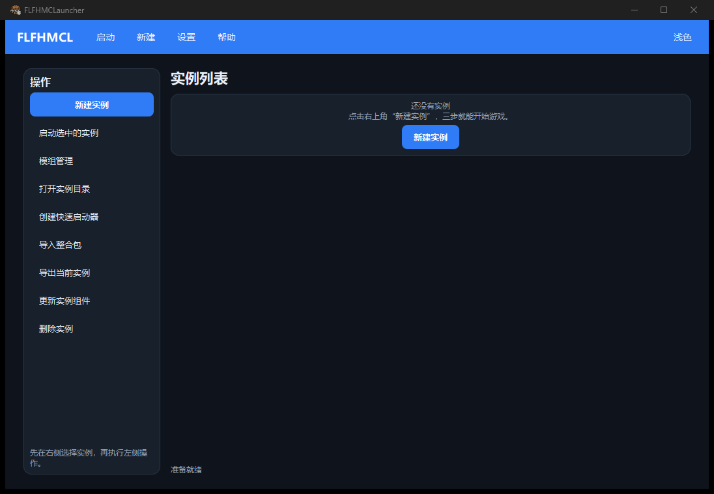

FLFHMCLauncher 是 FLFHMCL 的外壳和高阶入口。它不负责 Fabric 运行时本身，而是把“准备环境、创建实例、安装组件、启动 HMCL、管理模组和整合包”包装成一个可用的桌面程序。

即使不使用它，也可以直接用 Agent 启动 FLFHMCL；但使用它可以省去手工拼命令、管理目录和处理更新。



> 截图：FLFHMCLauncher 主界面。左侧为实例操作，右侧为实例列表；实际版本以你安装的构建为准。

## 一、安装

发布版是一个自包含 EXE。首次运行时，它把 GUI、快速启动器模板、spdlog 和 VC++ 运行库释放到：

```text
<启动器目录>/.flfhmcl/bin
```

之后从同一个 EXE 启动 GUI。要求：

- Windows 10/11 x64；
- 有写权限的目录；
- 足够的磁盘空间；
- 如被安全软件拦截，先核对文件来源和校验和。

> 📷 配图建议：首次运行释放目录的截图，标出 `.flfhmcl/bin` 与 GUI 文件。（待补图）

## 二、界面导览

主界面通常包含：

- 实例列表：创建、导入、启动；
- 账户：登录与切换；
- 下载：HMCL、Fabric、Java、组件；
- 设置：镜像、Java、更新、隔离；
- 日志/诊断：运行日志、崩溃报告、实例验证；
- 外部扩展入口：由第三方模组提供，不属于启动器核心。

## 三、创建实例

创建实例时需要选择：

1. HMCL 版本；
2. Fabric Loader 版本；
3. Java；
4. 游戏目录与隔离方式；
5. 是否安装 FLFHMCL Agent 与 FLF API。

建议新实例使用独立目录，避免多个实例共用 `.minecraft` 导致模组冲突。

## 四、安装与更新组件

启动器可以安装/更新：

- HMCL；
- FLFHMCL Agent；
- FLF API；
- Fabric Loader；
- 启动器自身。

更新前先备份实例。更新后检查日志中的 Agent 版本、API 版本与 HMCL 版本是否匹配。

## 五、启动与快速启动器

主启动：选择实例后点击启动，启动器生成 Java 命令并启动 HMCL。

快速启动器：

- 为指定实例生成一个独立 EXE；
- 默认名 `launch-<实例名>.exe`；
- 可改名、选图标；
- 启动时重新扫描当前模组目录，新增/删除模组不需要重新生成；
- HMCL 关闭后，快速启动器和 Java 进程应自动退出。

> 📷 配图建议：快速启动器创建对话框与生成后的 EXE 图标。（待补图）

## 六、模组管理

- 支持拖入、多选、批量启用/禁用；
- 自动识别重复 mod id；
- 生产实例不要放 Test 模组；
- 更新模组时保留用户配置；
- 删除模组后检查依赖是否仍然完整。

## 七、整合包

支持 `.flfhmclpack`：

- 导入：选择包文件，确认覆盖策略；
- 导出：选择实例与包含内容；
- 覆盖安装会保留用户数据（按包配置）；
- 升级前备份。

## 八、实例隔离

启动器支持私有、共享、分组三类目录策略：

- 私有：实例完全独立；
- 共享：多个实例共用游戏/模组；
- 分组：同组共享。

隔离影响模组、存档、配置的位置。切换隔离方式前先备份。

## 九、日志与修复

- 日志：实例目录下 `logs/latest.log`；
- 崩溃报告：`crash-report/`；
- 实例验证：检查缺失/重复/损坏文件；
- 修复实例：重新下载缺失组件；
- 清理缓存：删除可再生成的缓存，不动存档。

## 十、CLI 基础

```powershell
FLFLauncherCli.exe launch <实例id>
FLFLauncherCli.exe quickstart <实例id> <目标.exe>
FLFLauncherCli.exe validate <实例id>
FLFLauncherCli.exe repair <实例id>
```

CLI 适合脚本与服务器环境；GUI 适合日常使用。

## 十一、常见问题

| 现象 | 原因 | 处理 |
|---|---|---|
| 快速启动器不退出 | HMCL Java 进程未结束 | 更新 Agent，检查非 daemon 线程 |
| 新增模组不生效 | 快速启动器仍用旧快照 | 更新启动器/快速启动器模板 |
| 启动即失败 | Agent/API/HMCL 版本不匹配 | 对齐版本并看日志 |
| 下载卡住 | 镜像/网络问题 | 切换镜像，检查代理 |
| 中文路径失败 | 旧组件不支持 UTF-8 | 更新到当前版本 |
| 实例损坏 | 覆盖安装/磁盘问题 | 用验证/修复，必要时从备份恢复 |

## 十二、界面地图：每个区域做什么

下表以默认主题、默认窗口大小为准。

| 区域 | 位置 | 作用 | 常用操作 |
|---|---|---|---|
| 顶部导航 | 窗口最上方 | 切换主页面与深浅主题 | 点 **新建** 进创建页；点 **深色/浅色** 立即换主题 |
| 左侧边栏 | 启动页左侧 | 页面导航，底部显示 HMCL 版本 | 点 **启动HMCL** 回列表 |
| 操作卡片 | 启动页左栏 | 对选中实例执行动作 | 新建、启动、模组管理、打开目录、创建快速启动器、导入导出整合包、更新组件、删除 |
| 实例列表 | 启动页右侧 | 每张卡片一个实例，自带 **启动** | 单击选中；点卡片 **启动** 会先选中再启动 |
| 状态行 | 列表下方 | 实例总数与提示 | 无实例时提示先创建 |
| 设置页 | 顶部 **设置** | 校验/更新开关、启动后行为、数据目录 | 勾选 **启动前校验文件**、**启动前检查更新** 立即保存；**启动后** 选保持/隐藏/退出 |
| 新建实例页 | 顶部 **新建** | 名称、四个版本选择、隔离开关 | 每行有 **刷新** / **停止**，加载中显示细进度条 |
| 安装进度页 | 点 **开始下载** 后 | 左侧总进度，右侧分步明细 | 失败后出现 **重试**；修复复用同一页面 |
| 模组管理页 | 操作卡片 **模组管理** | 列出模组目录里的 jar | 勾选即启用；**导入模组**、**删除**、**返回** |
| 整合包向导 | **导入/导出整合包** | 两页：.hmcl 内容、确认模组 | 填 URL 只记录链接，留空则嵌入 jar |
| 崩溃对话框 | HMCL 非正常退出时 | 根因、建议、退出码与异常摘要 | **修复实例**、**复制诊断**、**打开报告文件夹** |
| 帮助与关于页 | 顶部 **帮助** | 简要说明与项目入口 | **打开项目主页** |

> 📷 配图建议：启动页全图，用编号标注顶部导航、操作卡片、实例卡片与状态行四处。（待补图）

## 十三、首次运行走查

按顺序做一遍，每步都给出出问题时可检查的落点。

1. 把 `FLFHMCLauncher.exe` 放进有写权限的目录，例如 `D:\Games\FLFHMCL\`，不要放 `C:\Program Files`。
2. 双击 EXE。引导器读自身尾部载荷，把 `FLFHMCLauncherApp.exe`、`FLFQuickStart.exe` 与运行库释放到 `<启动器目录>\.flfhmcl\bin`，并写 `.payload` 戳记。
3. 再次启动时，戳记与载荷一致且文件齐全就跳过释放，直接拉起 GUI。若提示“替换 … 失败（文件可能正在运行）”，先退出旧版本再启动。
4. GUI 起来后补齐骨架：`bin`、`config`、`libraries`、`java`、`javafx`、`fabric`、`hmcl`、`tools/CrashTracker`、`instances`、`cache/downloads`、`cache/meta`、`logs`、`crash-report`。
5. 约 1.5 秒后后台释放 CrashTracker：先用内置资源，校验不过再取 GitHub 最新 Release 的 `CrashTracker_Static.exe`，落到 `.flfhmcl\tools\CrashTracker`，并在 GUI 同目录放一份。失败只写日志。
6. 点 **新建**，确认 HMCL、FLFHMCL、Fabric Loader 三个列表都加载完。还在转圈时不要点 **开始下载**。
7. 进 **设置** 核对默认值：启动前校验（开）、启动前检查更新（开）、启动后行为（保持显示）。排障期可临时关掉前两项。
8. 填名称、选版本、决定是否隔离，点 **开始下载**；进度到 100% 且弹出“实例已创建”才算装完。
9. 回启动页点 **启动**。启动前先校验文件，再在后台检查组件更新；HMCL 输出出现 `Loading Done!` 时弹“HMCL 启动完成”。
10. 若 HMCL 异常退出，对话框给出根因与建议：先 **修复实例**，再不行用 **复制诊断** 带日志反馈。

更新检查有两个入口，别混淆：**设置 → 检查 HMCL 更新** 只查版本并提示“已经是最新版本”或“发现新版本”，不下载；**操作卡片 → 更新实例组件** 才真正下载替换。

## 十四、新建实例与组件安装

- **名称**：默认 `我的实例`。清空后红字提示“名称不能为空”；允许重名并提示“已有同名实例；仍会按 UUID 独立存储”，两个实例数据各落自己的 UUID 目录。
- **HMCL 版本**：先选通道（稳定版 / 预览版），再选具体版本。
- **FLFHMCL 版本**：同样分两档。`2.1` 到 `2.1.5` 被标为严重故障版本：创建时拦下并要求切到 `2.1.5` 或更高，启动时弹窗建议“更新实例”。
- **Fabric Loader**：单列，版本来自 Fabric 官方接口；加载失败回落到 `0.19.5` 并停用该项。
- **FLF API**：可选“不安装”。只列与当前 HMCL / FLFHMCL 组合适配的版本；没有适配组合时提示“没有适配 … 的 FLF API”，只能不装或换组合。
- **隔离开关**：`隔离 .minecraft 与 .hmcl 到 .launcher/<实例>`，新实例建议勾选，目录含义见第十八节。
- **安装内容**：Java 21（Temurin）、JavaFX、Fabric 库、HMCL jar 及依赖、FLFHMCL Agent、可选 FLF API。安装页分步显示“准备 Java”“下载 JavaFX”“安装 Fabric”“安装 HMCL 依赖”“安装 HMCL”等，可展开看子项百分比。
- **中断与重试**：进度页无取消按钮，关窗即中断；失败后出现 **重试**，只补缺失部分，不清空已下载的库。
- **更新组件**：在“更新实例组件”里勾选组件与目标版本，点 **开始更新**。更新覆盖 jar 并重建清单，存档与配置不动；仍建议先导出备份。

## 十五、模组管理：导入、启用与冲突处理

- **目录**：默认 `.flfhmcl\mods\<uuid>`；模组层设为 `shared` 时统一用 `.flfhmcl\mods\general`。
- **列表范围**：只列 `.jar` 与 `.jar.disabled`。勾选切换启用状态，实际是重命名加或去掉 `.disabled` 后缀，位置不变。
- **导入**：**导入模组** 可多选，也可把多个 jar 拖进列表。导入是覆盖语义：同名文件会被覆盖，不生成备份。
- **生效时机**：启动时把 Agent jar 与模组目录里所有 `.jar` 拼成 `-Dfabric.addMods` 传给 KnotClient，所以加删 jar 下次启动生效，不必重装实例。
- **同名不同版本**：两个文件会一起进 `addMods`，典型表现是启动报重复模组或类冲突。先删或先禁用旧版本，再放新版本。
- **同 mod id 不同文件名**（如 `foo-1.2.jar` 与 `foo-1.2-copy.jar`）：Fabric 在加载阶段报重复模组，HMCL 异常退出，摘要里能看到异常行。当前版本按文件名管理、不解析 jar 内 mod id，这类重复要靠日志确认。
- **重复 Fabric Loader**：日志出现 `duplicate fabric loader` 属清单问题，**修复实例** 会按实例选定版本重建清单并清理重复项。
- **依赖缺失**：`NoClassDefFoundError` 多为前置模组缺失或版本不匹配，补前置或修复实例。
- **删除之后**：删库类模组前确认没有其它模组依赖它；生产实例不要放 Test 模组。
- **文件名**：优先纯 ASCII；含中文时确认日志里路径编码正常。

> 📷 配图建议：模组管理页，标出勾选框、导入模组、删除与返回按钮，以及拖入多个 jar 的状态。（待补图）

## 十六、快速上手：创建、命名与图标、模组重扫、关闭行为

- **创建**：启动页选中实例 → **创建快速启动器** → 默认保存为 `<启动器目录>\launch-<实例名>.exe`。实例名里的 `< > : " / \ | ? *` 会被替换，名字为空时用 `instance`。
- **生成过程**：复制 `.flfhmcl\bin\FLFQuickStart.exe` 到目标路径，再把配置 JSON（`root`、`instance`、`modsDir`、`command`、`workingDir`、`checkUpdates`、`updateComponents`）以 `FLFQS01` 载荷追加到 EXE 末尾。生成后是单文件，可直接分发。
- **命名**：在保存对话框改文件名即可，缺扩展名补 `.exe`。**图标当前不支持选择**，生成的 EXE 沿用 `FLFQuickStart.exe` 的图标；也不要用资源编辑器重写它，尾部载荷可能被截断，双击会弹“未找到内嵌快速启动配置，也没有同目录 quickstart.json”。
- **更新检查**：生成前弹“快速启动器更新设置”，勾 **启用更新检查** 后再勾组件（HMCL / FLF API / FLFHMCL Agent / Fabric Loader / FLFHMCLauncher）。这些设置同时写回实例，普通启动也受影响。
- **modsDir 动态重扫**：每次双击都重扫 `modsDir` 里的 `.jar`，排序后重建 `-Dfabric.addMods`，不依赖生成时的快照，所以加删模组不必重新生成；`.jar.disabled` 不参与，改名的文件下次启动才按新名字加载。
  - 特例：生成后把模组目录挪走或清空，`modsDir` 仍指旧路径，表现为“模组全没了”。放回原路径或重新生成即可。
- **关闭与退出**：快速启动器用 `CreateProcess` 起 Java 并等待结束；HMCL 关闭后取子进程退出码并立即退出，自己返回同一退出码，不留窗口。HMCL 运行时任务管理器里应看到 `FLFQuickStart.exe` 与 `java.exe` 成对出现，只结束前者不会关掉游戏。
- **主启动器的启动后行为**：**设置 → 启动后** 三选一：保持显示（默认）、隐藏、退出。实例可在 **当前实例覆盖** 单独指定，选 **继承全局** 则跟随全局。选 **隐藏启动器** 后窗口隐藏且当前版本无托盘图标，要再打开只能重新运行启动器；不确定就用默认的“保持启动器显示”。选 **退出启动器** 则启动器进程结束，只留 HMCL。

## 十七、整合包：导入、导出与覆盖

- **三种导入入口**：把 `.flfhmclpack` 拖到窗口；启动页点 **导入整合包**；或把包拖到 `FLFHMCLauncher.exe` 图标上（引导器把命令行参数原样转给 GUI，GUI 识别扩展名后自动导入）。
- **导入规则**：生成新 UUID、强制 `isolated=true`（`.minecraft` 与 `.hmcl` 落 `.launcher/<uuid>`）、恢复目录/文件/空文件夹/运行时 jar、逐文件校验 SHA-256，最后写入 `instances.json` 并选中新实例，不覆盖全局 `.minecraft` / `.hmcl`。
- **“覆盖安装”覆盖什么**：导入永远新建实例，不覆盖已有实例；覆盖只发生在包内同一路径文件解到新实例目录时，以及链接型模组按 `sha256` 校验后下载覆盖。想“先删旧再导新”，请先手动删除旧实例。
- **导出**：两页向导。第一页选 `.hmcl` 内容（`.hmcl`、配置、状态、缓存、日志、`.minecraft/logs` 与 `crash-reports`；缓存和日志默认关；`accessToken`、`refreshToken`、`clientToken`、`password`、`secret`、`session` 自动清理）。第二页确认模组：留空嵌入 jar，填 URL 只导出链接，导入时按 `sha256` 下载校验。
- **建议**：升级前先导出；大实例导出前清掉截图与资源缓存；公开分发前仍要自查包里其它文件。

> 📷 配图建议：导出向导第二页“确认模组”，展示模组文件列与下载链接列，并标注“留空=嵌入”。（待补图）

## 十八、隔离与目录布局

下表以 EXE 所在目录为 `<启动器目录>`，`.flfhmcl` 与其同级：

| 路径 | 内容 | 说明 |
|---|---|---|
| `\.flfhmcl\bin` | GUI、`FLFQuickStart.exe`、运行库、`.payload` | 首次运行释放，删除后自动重建 |
| `\.flfhmcl\config\launcher.json` | 全局配置：HMCL 版本、镜像、启动后行为、校验与更新开关 | 手工编辑前先备份 |
| `\.flfhmcl\config\instances.json` | 实例列表：UUID、版本、隔离层、行为覆盖 | 与 CLI 共用，避免同时写 |
| `\.flfhmcl\instances\<uuid>` | 实例目录（旧版按 id 存放，启动时迁移到 UUID） | 一般不用手动进 |
| `\.flfhmcl\profile\<uuid>` | `instance.json`、`launch.json`、`mclhr.json` | 清单哈希记在实例配置 |
| `\.flfhmcl\mods\<uuid>`、`\.flfhmcl\mods\general` | 私有模组 / 共享模组 | 见下方隔离对照 |
| `\.flfhmcl\hmcl`、`agents`、`libraries`、`java`、`javafx`、`fabric` | HMCL、Agent、库、Java、JavaFX、Fabric | 共享运行时，由安装器补齐 |
| `\.flfhmcl\logs\launcher.log` | 启动器日志（启动与退出各一条） | 反馈问题要带上 |
| `\.flfhmcl\logs\instance-<uuid>.log` | 实例控制台输出，实时追加 | 与 HMCL 日志对照 |
| `\.flfhmcl\crash-report` | 启动器自身崩溃报告 | 崩溃处理器写入 |
| `\.flfhmcl\tools\CrashTracker` | CrashTracker 工具 | 后台释放 |
| `<启动器目录>\.launcher\<uuid>\.minecraft`、`\.hmcl` | 隔离实例的游戏目录与 HMCL 主目录 | `isolated=true` |
| `<启动器目录>\.minecraft`、`\.hmcl` | 未隔离实例共用 | 多实例共用会互相影响 |

隔离对照表：

| 层级 | private | shared | group |
|---|---|---|---|
| mods | `\.flfhmcl\mods\<uuid>` | `\.flfhmcl\mods\general` | 预留 `\.flfhmcl\shared\mods\<组名>` |
| minecraft / hmclHome | `isolated=true` 时落 `.launcher\<uuid>`，否则用同级 `.minecraft` / `.hmcl` | 同左，由隔离开关决定 | 同左 |

界面能直接切的是新建实例时的隔离开关；`mods`、`minecraft`、`hmclHome` 三层写在 `instances.json` 的同名字段（`mode` 取 `private` / `shared` / `group`，可带 `group`），改完重启生效。切换隔离方式前先备份存档与配置。

> 📷 配图建议：目录树示意图，左列 `.flfhmcl` 内部结构，右列 `.launcher\<uuid>` 与同级 `.minecraft` 的对比。（待补图）

## 十九、日志、崩溃与修复

- **先看哪里**：启动器异常看 `.flfhmcl\logs\launcher.log` 与 `.flfhmcl\crash-report`；实例起不来先看 `.flfhmcl\logs\instance-<uuid>.log`，再看 HMCL 写进 `crash-report` 的最新报告。
- **崩溃报告位置**：HMCL 报告写在 HMCL 主目录下的 `crash-report`：未隔离是 `.hmcl\crash-report`，隔离是 `.launcher\<uuid>\.hmcl\crash-report`。
- **异常退出对话框**：根因映射到几类已知问题——`Selected repository cannot be null` / `SambaException` / `config_loading_failure` 归为配置目录权限异常（ACL/Samba），此时应修 `.hmcl` 写权限而不要重建清单；`Configuration hasn't been loaded` 加 `AnimationUtils` 归为关闭动画初始化失败；`Configuration is already loaded` 归为设置重复初始化；`duplicate fabric loader` 归为重复 Loader；`Bootstrap failed` 归为 Fabric 引导失败；`UnsupportedClassVersion`、`OutOfMemoryError`、`NoClassDefFoundError` 分别对应 Java 版本、内存与类加载。除 ACL 一类外都提供 **修复实例**。
- **校验做什么**：检查 Java 路径、Agent jar、HMCL jar 存在且 SHA-1 匹配、`mclhr.json` 存在且哈希匹配、清单库条目字段完整无重复、`net.fabricmc:fabric-loader` 版本与实例一致；任一项失败给出具体原因。
- **修复做什么**：依次检查 Java、Agent、HMCL、Fabric Loader，补全缺失库，重建 profile 与 `mclhr` 清单，修完回启动页重试。
- **可以删的目录**：`cache\downloads`、`cache\meta` 删了会自动重建；`instances`、`profile`、`mods` 与存档不要删。
- **CLI 等价命令**见下一节；GUI 与 CLI 共用同一份 `.flfhmcl`，排障时先关 GUI 再跑 CLI。

## 二十、CLI 示例与退出码

```powershell
# 1. 连通性自检：版本列表、Fabric Loader、HMCL Release
FLFLauncherCli.exe selftest

# 2. 新建并安装实例（id、游戏版本、Fabric Loader、java.exe 路径）
FLFLauncherCli.exe install myinst 1.21.1 0.19.5 "C:\Java\jdk21\bin\java.exe"

# 3. 启动、校验、修复
FLFLauncherCli.exe launch myinst
FLFLauncherCli.exe validate myinst
FLFLauncherCli.exe repair myinst

# 4. 生成快速启动器
FLFLauncherCli.exe quickstart myinst "D:\Desktop\launch-myinst.exe"

# 5. 整合包导出与导入
FLFLauncherCli.exe export-pack myinst "D:\packs\myinst.flfhmclpack"
FLFLauncherCli.exe import-pack "D:\packs\myinst.flfhmclpack"
```

`install` 打印每一步 `[百分比] 步骤`，成功输出 `installed`；`export-pack` 输出文件数与字节数；`import-pack` 输出新实例 id、名称与文件数；`launch` 把 HMCL 输出透传到控制台。

| 退出码 | 含义 | 典型场景 |
|---|---|---|
| `0` | 成功 | 安装完成、校验通过、导入导出成功、`launch` 子进程退出码为 0 |
| `1` | 用法错误 | 没给参数或命令拼错，同时打印用法 |
| `2` | 找不到对象 | 实例 id 不存在；`install` 没取到可用 Fabric Loader |
| `3` | 操作失败 | 安装、修复、校验、导入导出或快速启动器写入失败 |
| `4` | `launch` 子进程非零退出 | HMCL 崩溃或 Java 启动失败 |

## 二十一、故障排查速查

| 现象（精确到提示或日志） | 原因 | 处理 |
|---|---|---|
| 双击快速启动器弹“未找到内嵌快速启动配置，也没有同目录 quickstart.json” | EXE 被截断或改写过，尾部 `FLFQS01` 载荷丢失 | 回启动器重新生成；不要用会重写文件的工具改它 |
| 快速启动器一闪而过，退出码非 0 | 配置缺 `command`，或 Java 路径失效 | 用校验或修复；检查实例配置里的 `javaPath` |
| 快速启动后模组全没了 | `modsDir` 指向的目录被移走或清空 | 放回原路径，或重新生成快速启动器 |
| 新放进去的 jar 不生效 | 后缀不是 `.jar`（`.jar.disabled`、`.jar.bak` 不参与），或放错实例目录 | 在模组管理页确认文件是否列出 |
| HMCL 启动即退出，日志有 `duplicate fabric loader` | 清单里有多个 Loader 版本 | **修复实例**，按实例选定版本重建清单 |
| 启动报 `UnsupportedClassVersion` | 实例 Java 版本过低 | 更新实例组件，或把 `javaPath` 指到更高版本 JDK |
| 提示“HMCL 配置目录权限异常（ACL/Samba）” | `.hmcl` 的继承 ACL 拒绝了写入判定 | 修目录权限后重试；不要重建 mclhr 清单 |
| `OutOfMemoryError` | 内存分配不足 | 降低内存或关掉占内存的程序 |
| `NoClassDefFoundError` | 前置模组或库缺失，或组件版本不匹配 | 补齐前置或 **修复实例** |
| 下载长期停在某个百分比 | 镜像、代理或网络中断 | 换镜像重试；必要时删 `cache\downloads` 再下 |
| 安装中途关窗后实例不完整 | 下载线程被中断，实例信息没写完 | 重新创建，或执行 **更新实例组件** |
| 导入整合包报 sha256 不匹配 | 包被改动，或链接型 jar 下载损坏 | 重新获取原包；确认包里 URL 可访问 |
| 实例列表出现多个同名实例 | 允许重名，数据按 UUID 存放 | 用 **打开实例目录** 确认是哪一个，再改名或删除 |
| 启动器隐藏后找不回 | 启动后行为设为“隐藏启动器”，且无托盘图标 | 重新运行启动器；改回“保持启动器显示” |
| 中文路径下启动失败 | 旧组件未按 UTF-8 处理路径 | 升级到当前版本；仍失败改用纯 ASCII 路径 |

> NSum Bridge、SSO 等外部组件不属于 FLFHMCLauncher 文档范围；界面中的外部扩展入口只说明其存在，不展开配置。
